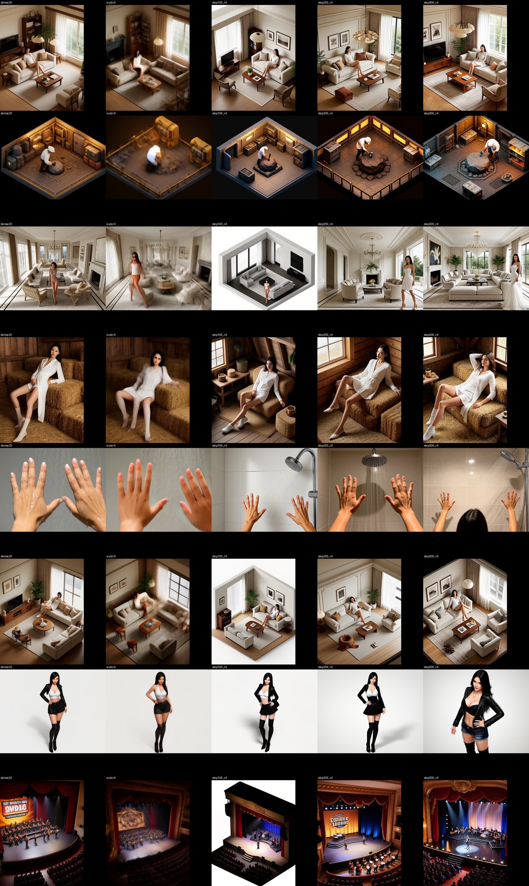
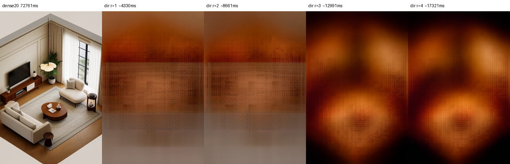
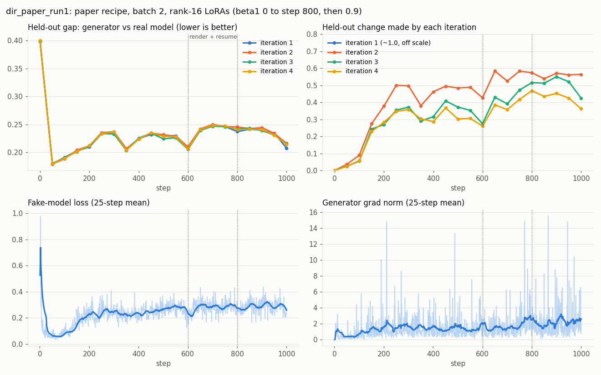

# dir-diffusion

Few-step generation by data-space iteration (DiR) with DMD distillation for the MiniMax H3 video DiT, optionally combined with [Level-of-Token layouts](https://github.com/scrya-com/lot-diffusion) per iteration, plus an experimental streaming-video extension.

**DiR is ByteDance Seed's method**: Shanchuan Lin, Yansong Peng, Fu-Yun Wang and Haoqi Fan, ["Few-Step Generation via Data-Space Iteration"](https://arxiv.org/abs/2610.12102) (arXiv 2610.12102). MiniMax H3 is MiniMax's model. This repository is an independent port to H3 and is not affiliated with either company.

**Getting started: [`DIR_CHEATSHEET.md`](DIR_CHEATSHEET.md)** covers preparing samples, caching latents and prompts, training, rendering and streaming. Explainer: [scrya.com/dir_diffusion](https://scrya.com/dir_diffusion).

> [!WARNING]
> **Experimental.** The paper's form (σ pinned to 1) trains on H3 but its generators ignore the estimate they are fed, so iterations 2–4 do not refine. A variant that is not in the paper (`--sigmas grid:6 --mix-state`) does refine: after 200 steps from base H3, 4 iterations give sharp images where base H3 at 4 steps is blurred, at 4–5× less DiT time than 20 steps. That is one short run on one single-style dataset, judged by eye on 8 held-out prompts. No weights are published. See [Results](#results-2026-11-17-what-works-on-h3-and-what-it-costs).

Dense H3 walks a 20-step noise schedule. DiR replaces the walk with a few refinements of the clean estimate: `x̂0⁽⁰⁾ = 0`, then `x̂0⁽ʳ⁺¹⁾ = G(x̂0⁽ʳ⁾, z, r)` for `r = 0 .. R−1` (R = 4). The same noise `z` is used at every iteration, there is no renoising and no sigma schedule. `G` is H3 at the noise end with three small additions:

- a zero-initialised projection of the previous estimate, summed into the target-video rows;
- an embedding of `r`, added to the target-video timestep embedding through a new AdaLN row, so text and audio modulation are unchanged;
- the flow time pinned to σ = 1 (`model_t_video = 0`), so `x̂0 = z + out` in H3's `x0 − eps` head convention.

Training is DMD. The frozen base H3 is the real model. A second LoRA on the same DiT, plus its own `r` embedding, is the fake model. The generator has its own LoRA. Neither the vendored musubi-tuner code nor H3's weights are modified.

**LoT per iteration.** Each iteration can run on its own LoT layout, e.g. `bands,bands,dense,dense`. DiR pins σ = 1, so LoT's eq. 9 never gets the low-σ carry-over of detail that LoT sampling relies on. A coarse region's detail has to come from the extent heads, which is why the late iterations stay dense.

## Results (2026-11-17): what works on H3, and what it costs

### The paper's pinned form does not read its estimate

`lot/probe_dir_h3.py` hands iteration r a controlled estimate (zeros, the 20-step latent from the same noise, or another prompt's latent) and measures where the output lands. On the two pinned-σ runs tested (run 1 at step 1000, zero-init rank 16; run E at step 200, Xavier init rank 128) the output is the same picture whatever is fed: about 0.69 mean absolute latent distance from the 20-step result in every case on run 1. The `x0_proj` path is new, the DMD loss does not require it to be used, and at this budget (LoRA, about 2,000 samples) it stays unused. So those runs are one-step generators repeated four times, and their iterations 2–4 only jitter the image.

### `--mix-state`: the estimate goes in through the pretrained input

With a sigma grid, iteration r sees `σ_r·z + (1 − σ_r)·x̂0⁽ʳ⁾`: its newest estimate re-noised with the same `z`, at flow time σ_r. The iteration is still a function of `(x̂0, z, r)` only, but **this departs from the paper**, which has no sigma schedule. Untrained base H3 already follows an estimate fed this way (0.10 from the 20-step latent when fed it at σ = 0.667, 0.83 when fed zeros, 0.97 when fed another prompt's latent; means over 8 prompts).

One run from base H3, no Turbo LoRA: rank-128 generator, rank-64 fake model, `--sigmas grid:6 --mix-state --zero-init --dmd-draws 4 --fake-warmup 100 --ema 0 --accum 2`, 300 steps on 793 isometric-3D stills at 48×48 latent crops.


Step 200, 8 held-out prompts, same noise per row. Columns: base H3 at 20 steps, base H3 at 4 Euler steps, then the trained generator after 1, 2, 3, 4 iterations.

- **It refines.** Iteration 1 is a soft but recognisable image and iterations 2–4 add detail. Iteration 4 is sharp on all 8 prompts; base H3 at 4 steps is blurred and ghosted on all 8.
- **It still reads its estimate after training.** Fed the 20-step latent, iteration 4 lands 0.19 from it; fed zeros, 0.88; fed another prompt's latent, 1.01.
- **It is not the 20-step image.** For the same noise the composition differs (0.63 from the 20-step latent; base H3 at 4 steps is 0.45 from it). It is a different sample of the same prompt.
- **It is unstable across checkpoints.** At step 100, three prompts collapsed to an isometric cutaway on a white background. At step 200 that is gone. At step 300 one prompt changes rendering style and the concert loses its sign. EMA was off; the held-out score swings by 0.03–0.06 between adjacent evals. Step 200 was chosen by eye.



Columns: 20 steps, base 4 steps, then iteration 4 at steps 100, 200 and 300.

What this does not show: the run changes three things at once (`--mix-state`, the fake warm-up, 4 DMD draws) and there is no base-start arm without `--mix-state`; there is no FID, one seed per prompt, and one training style. The same recipe started from the Turbo LoRA refined but did not beat Turbo's own 4-step sampler at step 100, and drifted in content on two prompts.

### Speed and memory

`lot/bench_dir_h3.py`, rank-128 LoRA, stills, DiT only (text encoder, VAE and the CUDA context are excluded), nothing else running on the card. Peak is `torch.cuda.max_memory_allocated`.

| Card | Block swap | Canvas | One forward | Dense 20 steps | DiR 4 iterations | Ratio | Peak |
|---|---|---|---|---|---|---|---|
| RTX 5090 (32 GB) | 0 | 768×768 | 0.081 s | 1.63 s | 0.39 s | 4.2× | 21.3 GB |
| RTX 5090 (32 GB) | 0 | 1344×768 | 0.145 s | 2.90 s | 0.69 s | 4.2× | 21.5 GB |
| RTX 5090 (32 GB) | 4 | 768×768 | 0.35 s | 6.69 s | 1.36 s | 4.9× | 20.6 GB |
| RTX 5090 (32 GB) | 4 | 1344×768 | 0.35 s | 6.67 s | 1.36 s | 4.9× | 20.7 GB |
| RTX PRO 4000 (24 GB) | 8 | both | out of memory with a desktop holding 5 GB | | | | |
| RTX PRO 4000 (24 GB) | 12 | 768×768 | 5.4 s | 111 s | 22.0 s | 5.1× | 17.7 GB |
| RTX PRO 4000 (24 GB) | 12 | 1344×768 | 5.4 s | 107 s | 21.5 s | 5.0× | 17.8 GB |
| RTX PRO 4000 (24 GB) | 16 | 768×768 | 6.8 s | 140 s | 28.2 s | 5.0× | 16.2 GB |
| RTX PRO 4000 (24 GB) | 16 | 1344×768 | 7.2 s | 144 s | 28.3 s | 5.1× | 16.3 GB |

- **The speed-up is the step ratio.** A DiR iteration is one H3 forward, so 4 iterations against 20 steps is at most 5×. With no block swap the unmerged LoRA adds 20% per forward (97 ms against 81 ms), which gives 4.2×.
- **Same cost as any 4-step sampler.** H3 Turbo at 4 steps costs the same per image. DiR's case has to be quality per forward, not speed.
- **Block swap dominates once it is on.** Swap 4 makes the forward 2.4× to 4.3× slower on the 5090, and on the 24 GB card the time does not depend on the canvas at all. Fitting the model in memory matters more than the token count there.
- **Memory is the model, not the method.** DiR adds about 0.1 GB over the dense pass. The dense figures were measured with the LoRA loaded but switched off, so plain H3 needs a little less.

Training, same run, RTX 5090, swap 4:

| | |
|---|---|
| One step (2 accumulated samples, 4 DMD draws, 4 fake-model updates) | 21.5 s median |
| Fake-model warm-up | 100 updates at about 10 s |
| Held-out eval (8 prompts, 4 iterations) | about 27 s, every 20 steps |
| 300 steps including warm-up, evals and saves | 2 h 18 min |
| Peak memory | 24.9 GB: does not fit a 24 GB card at swap 4 |

## Status

The rows below are the earlier pinned-σ runs. Read them with the finding above: their iterations do not refine.

| What | Result |
|---|---|
| `parity_h3.py`: LoT 1×1 == dense H3 | `rel_rms=0`, unchanged |
| `parity_dir_h3.py`: generalised forward == `predict`; zero extras are a no-op; the `r` delta moves only video rows | ok=1 |
| `train_dir_h3.py --check`: dense and `bands,bands,dense,dense` | ok=1; fake == real at init; each update touches only its own parameters |
| DiT time, 768×1152 still, untrained, swap 4 | dense 20 steps 72.8 s · DiR 4 iterations 17.3 s (4.2×) |
| Paper-recipe training, 24 GB card, swap 4, 48×48 latent crops | 70 s per generator update, peak 21.3 GB |
| Held-out eval, step 50 | generator-vs-real gap 0.40 → 0.18; iterations 2–4 change the estimate by 0.036, 0.025, 0.024 |
| Step 1000 (run 1), 768×1152, swap 4 | dense 20 steps 35.8 s · DiR 4 iterations 6.6 s (**5.4×**); held-out gap 0.21 |
| Image quality vs dense H3 | layout, light and materials follow the prompt; textures still busier; a person in one held-out prompt is erased ([renders](https://github.com/johndpope/MiniMax-H3/issues/3)) |
| `parity_stream_h3.py`: streaming window == still DiR step and stock FL2VA | rel. error 0 (bit-identical), ok=1 |
| Streaming, 7×48×48 window, warm-started from step 1000 | 3.3 s per forward; 17-frame clip in ~20 s; scene holds across clips ([videos](https://github.com/johndpope/MiniMax-H3/issues/3)) |


Step 1000, live weights. Columns: dense 20-step H3, then DiR after 1, 2, 3, 4 iterations, same seed.



Untrained, every DiR column is H3's blurry one-step mean (the zero head ignores `x̂0`, and the trained pinned-σ runs tested still do); the `bands` columns use an unfitted adapter.



## Quick start

```bash
git clone https://github.com/scrya-com/dir-diffusion && cd dir-diffusion
pip install -r requirements.txt
hf download Comfy-Org/MiniMax-H3 diffusion_models/minimax_h3_fl2va_pruned_int8_convrot.safetensors --local-dir models
export LOT_H3_CHECKPOINT=$PWD/models/diffusion_models/minimax_h3_fl2va_pruned_int8_convrot.safetensors
export LOT_H3_VAE=/path/to/minimax_h3_video_vae_fp16.safetensors
export LOT_H3_STILLS_CACHE=/path/to/h3_cache          # *_minimaxh3.safetensors + *_minimaxh3_te.safetensors

python3 lot/test_lot.py                                # CPU -> last line "ok N"
python3 lot/parity_h3.py                               # GPU -> ok=1
python3 lot/parity_dir_h3.py                           # GPU -> ok=1
python3 lot/render_dir_h3.py --untrained --prompts 1 --swap 4         # smoke: dense 20-step vs untrained DiR

# dry pass, then the paper's recipe (Table 4), batch 1 with 2-sample accumulation
python3 lot/train_dir_h3.py --check --swap 4 --max-latent-hw 48 48
LOT_H3_TRAIN=1 python3 lot/train_dir_h3.py --swap 4 --max-latent-hw 48 48 \
  --accum 2 --steps 1000 --eval-every 50 --save-every 100 --eval-anchors --out lot/runs/dir_a   # defaults = the paper's recipe

python3 lot/render_dir_h3.py --run lot/runs/dir_a --ema --prompts 3 --swap 4   # -> grid.png + meta.json
```

Building a cache from your own clips, and every path variable, are covered in [`lot/README.md`](lot/README.md) and [`lot/lot_paths.py`](lot/lot_paths.py). A LoT schedule (`--schedule bands,bands,dense,dense`) needs `--pairs DIR` for the extent bank; warm-start the generator from a LoT run with `--init` (e.g. `run4_nikki_distill` from [HF johndpope/MiniMax-H3-LoT](https://huggingface.co/johndpope/MiniMax-H3-LoT)) and add `--train-adapter` to fine-tune its heads.

## What is here

| Path | What |
|---|---|
| [`lot/dir_h3.py`](lot/dir_h3.py) | `DirHead` / `DirFakeHead`, the generator step, real and fake x0 predictions, LoRA switching, layout schedules, `dir_sample`, run save/load |
| [`lot/train_dir_h3.py`](lot/train_dir_h3.py) | DMD trainer: self-rollout, generator and fake updates, the paper's weighting / τ / optimizer options, EMA, `--accum`, `--check` |
| [`lot/render_dir_h3.py`](lot/render_dir_h3.py) | Dense 20-step vs DiR after 1..R iterations on held-out prompts, VAE decode, grid and timings |
| [`lot/parity_dir_h3.py`](lot/parity_dir_h3.py) | GPU parity for the DiR forward |
| [`lot/probe_dir_h3.py`](lot/probe_dir_h3.py) | Does a generator refine, and does it read its estimate: rollout and controlled-feed distances on held-out prompts, picture grid |
| [`lot/bench_dir_h3.py`](lot/bench_dir_h3.py) | Time and peak memory of DiR sampling against the dense sampler, per canvas |
| [`lot/stream_dir_h3.py`](lot/stream_dir_h3.py) | Streaming DiR: sliding 5n+2 window, per-frame `r`, FL2VA first-frame hand-off, coarse memory keyframes |
| [`lot/train_stream_dir_h3.py`](lot/train_stream_dir_h3.py) / [`lot/render_stream_h3.py`](lot/render_stream_h3.py) / [`lot/parity_stream_h3.py`](lot/parity_stream_h3.py) | Streaming DMD trainer, mp4 renderer, GPU parity and timing |
| [`DIR_CHEATSHEET.md`](DIR_CHEATSHEET.md) | Getting started: samples, cache, training recipe, renders, streaming |
| [`lot/h3_musubi.py`](lot/h3_musubi.py) | H3 runtime glue; `forward_video` with the `video_extra` and `video_temb_delta` hooks |
| [`lot/`](lot) (rest) | Level-of-Token Diffusion for H3, unchanged from [scrya-com/lot-diffusion](https://github.com/scrya-com/lot-diffusion); start at [`lot/CHEATSHEET.md`](lot/CHEATSHEET.md) |
| [`third_party/musubi_tuner/`](third_party) | The unmodified subset of [kohya-ss/musubi-tuner](https://github.com/kohya-ss/musubi-tuner) that runs H3 (Apache-2.0; see [`NOTICE`](NOTICE)) |
| [`comfyui/`](comfyui) | LoT ComfyUI workflows (DiR has no ComfyUI node yet) |

Differences from the paper: batch 1 with `--accum` instead of batch 256 (about 2,000 samples in run 1 against the paper's roughly 50 million); rank-16 to 128 LoRAs for the generator and the fake model instead of full fine-tunes; text-to-image on H3 where the paper tests class-conditional ImageNet 256 only; no CFG on the real model yet (the paper's best uses 1.1 over τ ≤ 0.6), because H3 needs a cached empty-prompt embedding for it. Run 1 and the Turbo arms A–C also used zero init, random `r` and EMA 0.999; the defaults are now the paper's.

## Weights and license

- Code in `lot/` and `comfyui/`: Apache-2.0 ([`LICENSE`](LICENSE)).
- `third_party/musubi_tuner/`: Apache-2.0, from musubi-tuner, which adapts it from Hugging Face Diffusers; see [`NOTICE`](NOTICE).
- MiniMax H3 weights, and anything trained from them, are under the [MiniMax H3 Community License](https://huggingface.co/MiniMaxAI/MiniMax-H3/blob/main/LICENSE): **not for use in the EU, UK, South Korea or USA**, and keep its `LICENSE` and `NOTICE` with any copy.

## Citation

- Data-space iteration: Lin, Peng, Wang, Fan. *Few-Step Generation via Data-Space Iteration*. [arXiv 2610.12102](https://arxiv.org/abs/2610.12102).
- Level-of-Token Diffusion: Nakayama et al. [arXiv 2610.05816](https://arxiv.org/abs/2610.05816).
