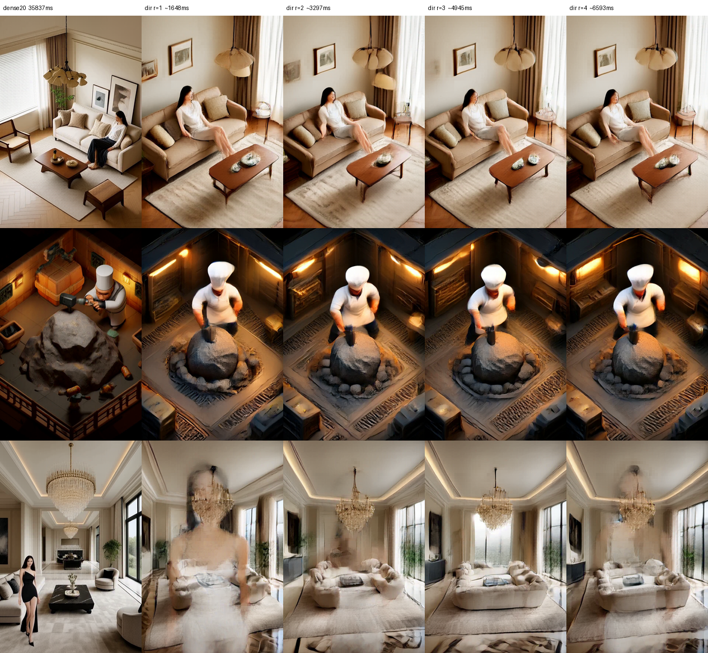
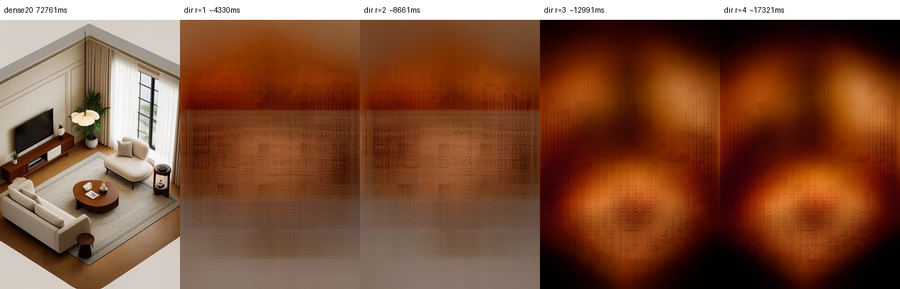
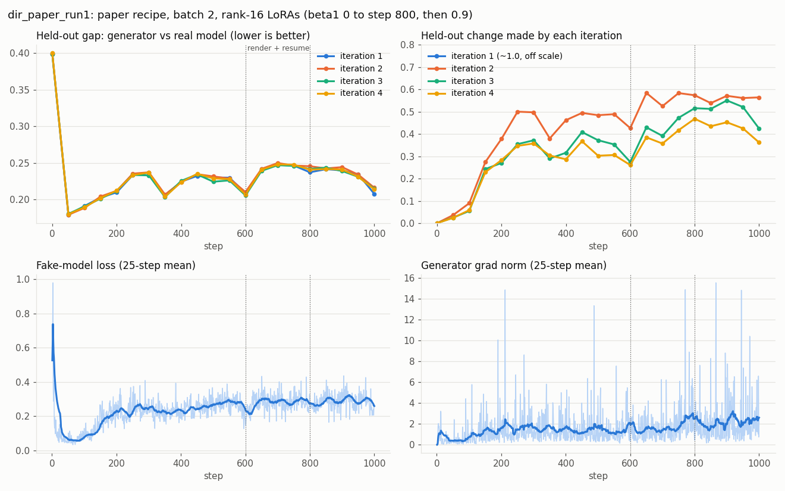

# dir-diffusion

Few-step generation by data-space iteration (DiR) with DMD distillation for the MiniMax H3 video DiT, optionally combined with [Level-of-Token layouts](https://github.com/scrya-com/lot-diffusion) per iteration, plus an experimental streaming-video extension.

**DiR is ByteDance Seed's method**: Shanchuan Lin, Yansong Peng, Fu-Yun Wang and Haoqi Fan, ["Few-Step Generation via Data-Space Iteration"](https://arxiv.org/abs/2610.12102) (arXiv 2610.12102). MiniMax H3 is MiniMax's model. This repository is an independent port to H3 and is not affiliated with either company.

**Getting started: [`DIR_CHEATSHEET.md`](DIR_CHEATSHEET.md)** covers preparing samples, caching latents and prompts, training, rendering and streaming. Explainer: [scrya.com/dir_diffusion](https://scrya.com/dir_diffusion).

> [!WARNING]
> **Experimental.** One 1,000-step run on one 24 GB card: 5.4× less DiT time than dense H3, with pictures not yet as good. People can vanish and textures overshoot. No weights are published. Status, losses and renders: [johndpope/MiniMax-H3 issue 3](https://github.com/johndpope/MiniMax-H3/issues/3).

Dense H3 walks a 20-step noise schedule. DiR replaces the walk with a few refinements of the clean estimate: `x̂0⁽⁰⁾ = 0`, then `x̂0⁽ʳ⁺¹⁾ = G(x̂0⁽ʳ⁾, z, r)` for `r = 0 .. R−1` (R = 4). The same noise `z` is used at every iteration, there is no renoising and no sigma schedule. `G` is H3 at the noise end with three small additions:

- a zero-initialised projection of the previous estimate, summed into the target-video rows;
- an embedding of `r`, added to the target-video timestep embedding through a new AdaLN row, so text and audio modulation are unchanged;
- the flow time pinned to σ = 1 (`model_t_video = 0`), so `x̂0 = z + out` in H3's `x0 − eps` head convention.

Training is DMD. The frozen base H3 is the real model. A second LoRA on the same DiT, plus its own `r` embedding, is the fake model. The generator has its own LoRA. Neither the vendored musubi-tuner code nor H3's weights are modified.

**LoT per iteration.** Each iteration can run on its own LoT layout, e.g. `bands,bands,dense,dense`. DiR pins σ = 1, so LoT's eq. 9 never gets the low-σ carry-over of detail that LoT sampling relies on. A coarse region's detail has to come from the extent heads, which is why the late iterations stay dense.

## Status

| What | Result |
|---|---|
| `parity_h3.py`: LoT 1×1 == dense H3 | `rel_rms=0`, unchanged |
| `parity_dir_h3.py`: generalised forward == `predict`; zero extras are a no-op; the `r` delta moves only video rows | ok=1 |
| `train_dir_h3.py --check`: dense and `bands,bands,dense,dense` | ok=1; fake == real at init; each update touches only its own parameters |
| DiT time, 768×1152 still, untrained, swap 4 | dense 20 steps 72.8 s · DiR 4 iterations 17.3 s (4.2×) |
| Paper-recipe training, 24 GB card, swap 4, 48×48 latent crops | 70 s per generator update, peak 21.3 GB |
| Held-out eval, step 50 | generator-vs-real gap 0.40 → 0.18; iterations 2–4 change the estimate by 0.036, 0.025, 0.024 |
| Step 1000 (run 1), 768×1152, swap 4 | dense 20 steps 35.8 s · DiR 4 iterations 6.6 s (**5.4×**); held-out gap 0.21 |
| Image quality vs dense H3 | layout, light and materials follow the prompt; textures still busier; a person in one held-out prompt is erased ([renders](https://github.com/johndpope/MiniMax-H3/issues/3)) |
| `parity_stream_h3.py`: streaming window == still DiR step and stock FL2VA | rel. error 0 (bit-identical), ok=1 |
| Streaming, 7×48×48 window, warm-started from step 1000 | 3.3 s per forward; 17-frame clip in ~20 s; scene holds across clips ([videos](https://github.com/johndpope/MiniMax-H3/issues/3)) |



Step 1000, live weights. Columns: dense 20-step H3, then DiR after 1, 2, 3, 4 iterations, same seed.



Untrained, every DiR column is H3's blurry one-step mean (the head ignores `x̂0` until trained); the `bands` columns use an unfitted adapter.



## Quick start

```bash
git clone https://github.com/scrya-com/dir-diffusion && cd dir-diffusion
pip install -r requirements.txt
hf download Comfy-Org/MiniMax-H3 diffusion_models/minimax_h3_fl2va_pruned_int8_convrot.safetensors --local-dir models
export LOT_H3_CHECKPOINT=$PWD/models/diffusion_models/minimax_h3_fl2va_pruned_int8_convrot.safetensors
export LOT_H3_VAE=/path/to/minimax_h3_video_vae_fp16.safetensors
export LOT_H3_STILLS_CACHE=/path/to/h3_cache          # *_minimaxh3.safetensors + *_minimaxh3_te.safetensors

python3 lot/test_lot.py                                # CPU -> ok 32
python3 lot/parity_h3.py                               # GPU -> ok=1
python3 lot/parity_dir_h3.py                           # GPU -> ok=1
python3 lot/render_dir_h3.py --untrained --prompts 1 --swap 4         # smoke: dense 20-step vs untrained DiR

# dry pass, then the paper's recipe (Table 4), batch 1 with 2-sample accumulation
python3 lot/train_dir_h3.py --check --swap 4 --max-latent-hw 48 48
LOT_H3_TRAIN=1 python3 lot/train_dir_h3.py --swap 4 --max-latent-hw 48 48 \
  --dmd-weight paper --betas 0 0.95 --grad-clip 0 --fake-updates 4 --tau-shift beta:2.5 \
  --accum 2 --ema 0.999 --steps 1000 --eval-every 50 --save-every 100 --out lot/runs/dir_a

python3 lot/render_dir_h3.py --run lot/runs/dir_a --ema --prompts 3 --swap 4   # -> grid.png + meta.json
```

Building a cache from your own clips, and every path variable, are covered in [`lot/README.md`](lot/README.md) and [`lot/lot_paths.py`](lot/lot_paths.py). A LoT schedule (`--schedule bands,bands,dense,dense`) needs `--pairs DIR` for the extent bank; warm-start the generator from a LoT run with `--init` (e.g. `run4_nikki_distill` from [HF johndpope/MiniMax-H3-LoT](https://huggingface.co/johndpope/MiniMax-H3-LoT)) and add `--train-adapter` to fine-tune its heads.

## What is here

| Path | What |
|---|---|
| [`lot/dir_h3.py`](lot/dir_h3.py) | `DirHead` / `DirFakeHead`, the generator step, real and fake x0 predictions, LoRA switching, layout schedules, `dir_sample`, run save/load |
| [`lot/train_dir_h3.py`](lot/train_dir_h3.py) | DMD trainer: self-rollout, generator and fake updates, the paper's weighting / τ / optimizer options, EMA, `--accum`, `--check` |
| [`lot/render_dir_h3.py`](lot/render_dir_h3.py) | Dense 20-step vs DiR after 1..R iterations on held-out prompts, VAE decode, grid and timings |
| [`lot/parity_dir_h3.py`](lot/parity_dir_h3.py) | GPU parity for the DiR forward |
| [`lot/stream_dir_h3.py`](lot/stream_dir_h3.py) | Streaming DiR: sliding 5n+2 window, per-frame `r`, FL2VA first-frame hand-off, coarse memory keyframes |
| [`lot/train_stream_dir_h3.py`](lot/train_stream_dir_h3.py) / [`lot/render_stream_h3.py`](lot/render_stream_h3.py) / [`lot/parity_stream_h3.py`](lot/parity_stream_h3.py) | Streaming DMD trainer, mp4 renderer, GPU parity and timing |
| [`DIR_CHEATSHEET.md`](DIR_CHEATSHEET.md) | Getting started: samples, cache, training recipe, renders, streaming |
| [`lot/h3_musubi.py`](lot/h3_musubi.py) | H3 runtime glue; `forward_video` with the `video_extra` and `video_temb_delta` hooks |
| [`lot/`](lot) (rest) | Level-of-Token Diffusion for H3, unchanged from [scrya-com/lot-diffusion](https://github.com/scrya-com/lot-diffusion); start at [`lot/CHEATSHEET.md`](lot/CHEATSHEET.md) |
| [`third_party/musubi_tuner/`](third_party) | The unmodified subset of [kohya-ss/musubi-tuner](https://github.com/kohya-ss/musubi-tuner) that runs H3 (Apache-2.0; see [`NOTICE`](NOTICE)) |
| [`comfyui/`](comfyui) | LoT ComfyUI workflows (DiR has no ComfyUI node yet) |

Differences from the paper, on purpose: batch 1 with `--accum` instead of batch 256; zero-initialised `x̂0` projection and `r` embeddings (the paper uses random init) so the untrained generator equals the base one-step prediction; EMA 0.999 instead of 0.9999 at our step counts; no CFG on the real model yet (the paper's best uses 1.1 over τ ≤ 0.6), because H3 needs a cached empty-prompt embedding for it.

## Weights and license

- Code in `lot/` and `comfyui/`: Apache-2.0 ([`LICENSE`](LICENSE)).
- `third_party/musubi_tuner/`: Apache-2.0, from musubi-tuner, which adapts it from Hugging Face Diffusers; see [`NOTICE`](NOTICE).
- MiniMax H3 weights, and anything trained from them, are under the [MiniMax H3 Community License](https://huggingface.co/MiniMaxAI/MiniMax-H3/blob/main/LICENSE): **not for use in the EU, UK, South Korea or USA**, and keep its `LICENSE` and `NOTICE` with any copy.

## Citation

- Data-space iteration: Lin, Peng, Wang, Fan. *Few-Step Generation via Data-Space Iteration*. [arXiv 2610.12102](https://arxiv.org/abs/2610.12102).
- Level-of-Token Diffusion: Nakayama et al. [arXiv 2610.05816](https://arxiv.org/abs/2610.05816).
