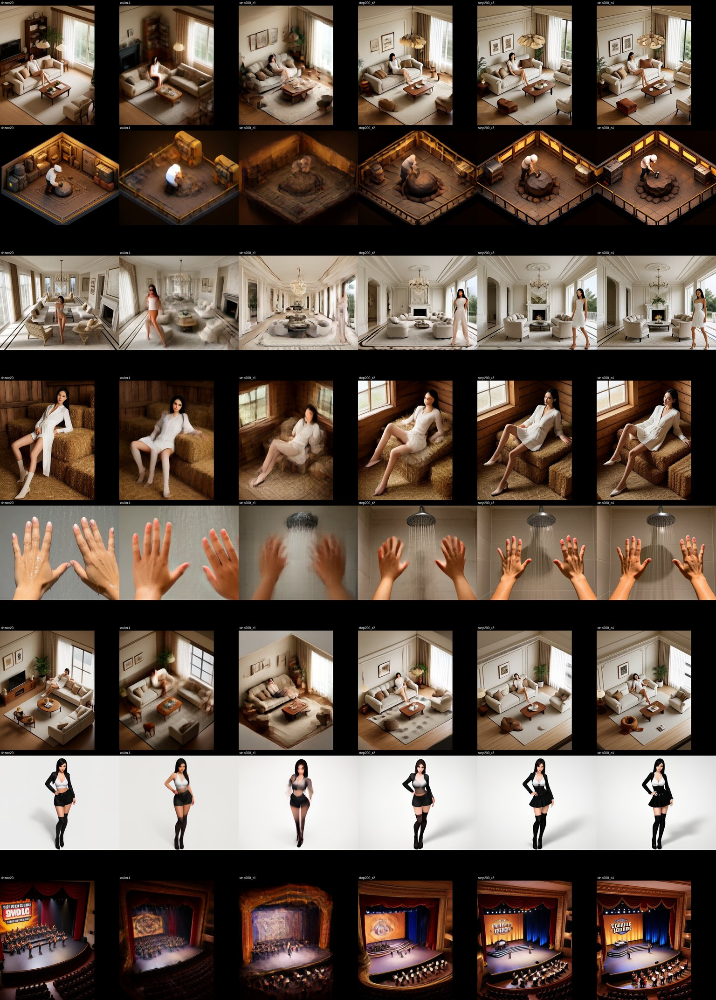
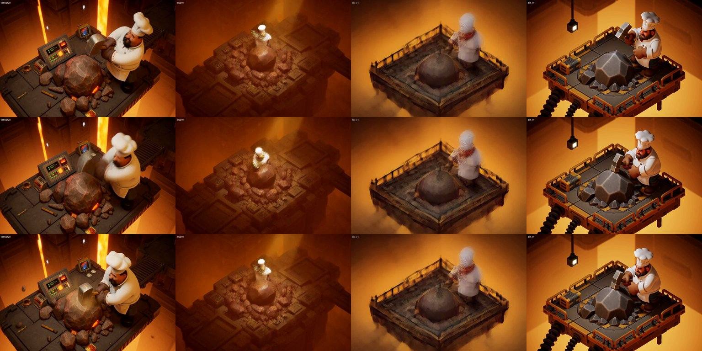
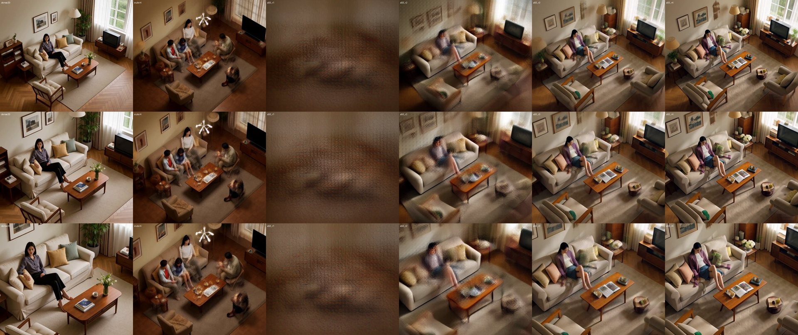
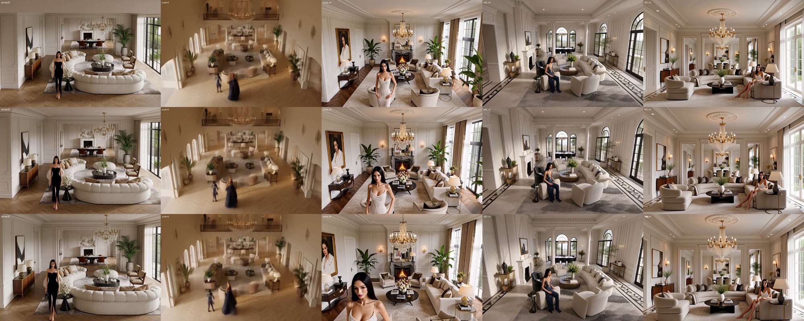
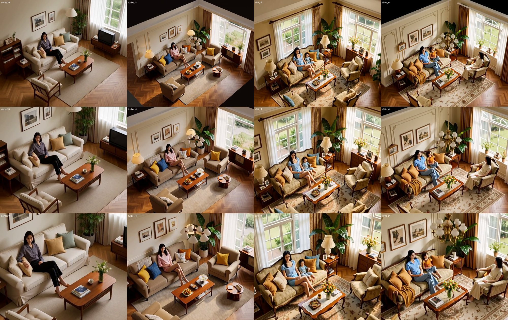
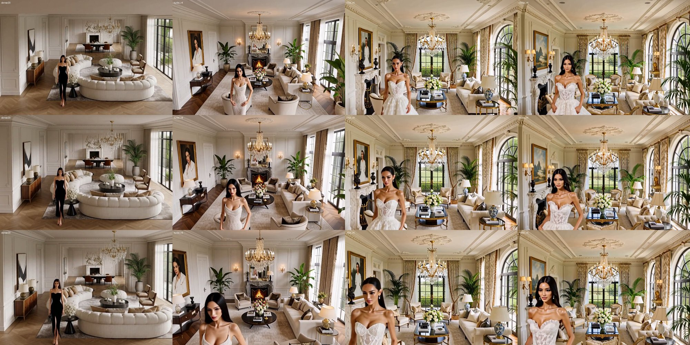
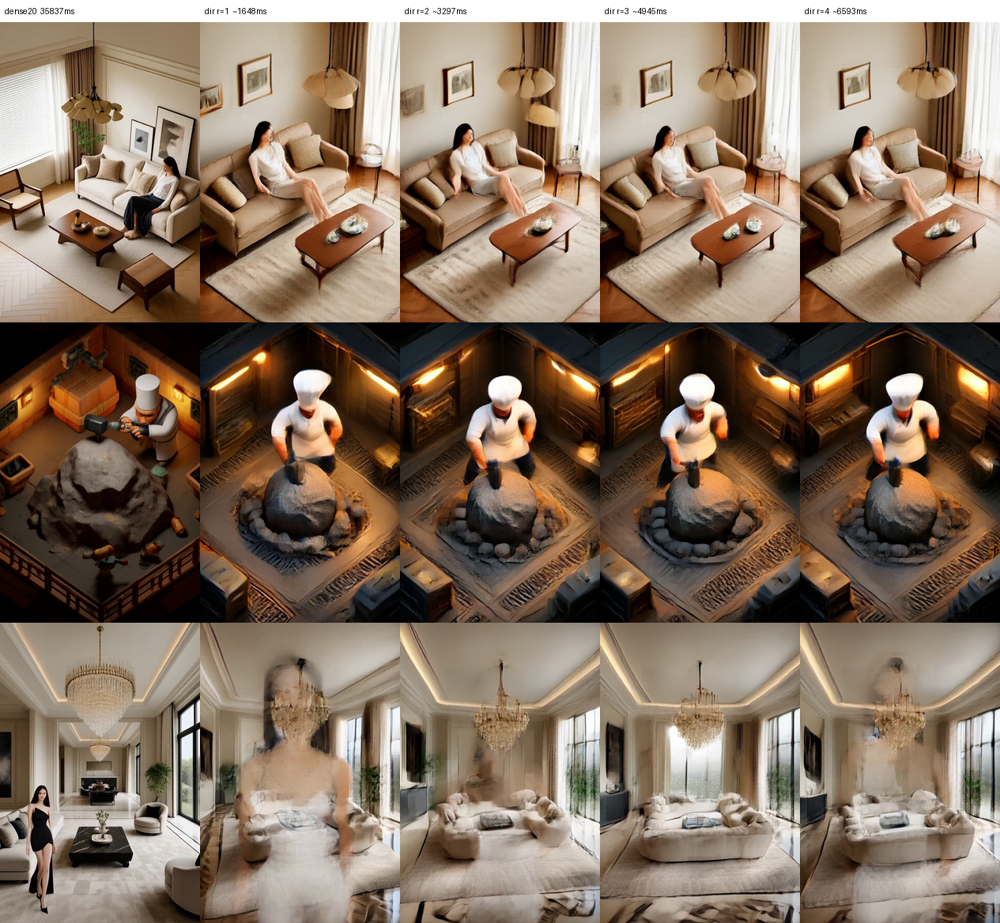

# dir-diffusion

Few-step generation by data-space iteration (DiR) with DMD distillation for the MiniMax H3 video DiT, optionally combined with [Level-of-Token layouts](https://github.com/scrya-com/lot-diffusion) per iteration, plus an experimental streaming-video extension.

**DiR is ByteDance Seed's method**: Shanchuan Lin, Yansong Peng, Fu-Yun Wang and Haoqi Fan, ["Few-Step Generation via Data-Space Iteration"](https://arxiv.org/abs/2610.12102) (arXiv 2610.12102). MiniMax H3 is MiniMax's model. This repository is an independent port to H3 and is not affiliated with either company.

**Getting started: [`DIR_CHEATSHEET.md`](DIR_CHEATSHEET.md)** covers preparing samples, caching latents and prompts, training, rendering and streaming. Explainer: [scrya.com/dir_diffusion](https://scrya.com/dir_diffusion).

> [!WARNING]
> **Experimental.** The paper's form (σ pinned to 1) trains on H3 but its generators ignore the estimate they are fed, so iterations 2–4 do not refine. A variant that is not in the paper (`--sigmas grid:6 --mix-state`) does refine: after 200 steps from base H3, 4 iterations give sharp images where base H3 at 4 steps is blurred, at 4–5× less DiT time than 20 steps. That is one short run on one single-style dataset, judged by eye on 8 held-out prompts. Trained on clip-shaped noise, the same recipe gives moving clips at step 50 (three prompts checked). No weights are published. See [Results](#results-2026-11-17-what-works-on-h3-and-what-it-costs).

## News

- **2026-11-20: DWD, decoding without a decoder.** A linear head reads pixels straight from H3's last layer at DiR's final iteration, after Hansheng Chen, Shengqu Cai, Jan Ackermann, Rayhan Zirvi, Gordon Wetzstein, Xinchen Yan and Leonidas Guibas, ["Decoding Without a Decoder"](https://arxiv.org/abs/2611.22287).
  - **Pipeline:** a final-iteration LoRA, then a small refiner that also reads the latent.
  - **Results:** against the VAE decode, held-out LPIPS goes 0.466 → **0.115**. PSNR is 27.0 dB on isometric scenes, 33.1 dB on portraits, and 27.7 dB on known-character prompts the refiner never saw.
  - **Speed:** about 0.27 s per 39-frame 512×768 clip on an RTX 5090, against 1.8 s for the VAE.
  - **Links:** [`docs/DWD.md`](docs/DWD.md), [issue #6](https://github.com/scrya-com/dir-diffusion/issues/6) (with pictures), [scrya.com/dwd_diffusion](https://scrya.com/dwd_diffusion).
  - **Code:** `lot/dwd_h3.py`, `lot/train_dwd_h3.py`, `lot/refine_dwd_h3.py`. No weights are published yet.
- **2026-11-19: Neighbor Forcing + ConvKV memory for H3** (SoulX-LiveAct). The text-prefix fix restores character likeness in streamed H3. See [`docs/SOULX_LIVEACT.md`](docs/SOULX_LIVEACT.md), [issue #5](https://github.com/scrya-com/dir-diffusion/issues/5) and [scrya.com/neighbor_forcing](https://scrya.com/neighbor_forcing).
- **2026-11-17: DiR research checkpoint** on [Hugging Face](https://huggingface.co/johndpope/dir-diffusion-h3) (per-iteration fake model, step 100, averaged weights). It trades Turbo's over-motion for over-detail.

Dense H3 walks a 20-step noise schedule. DiR replaces the walk with a few refinements of the clean estimate: `x̂0⁽⁰⁾ = 0`, then `x̂0⁽ʳ⁺¹⁾ = G(x̂0⁽ʳ⁾, z, r)` for `r = 0 .. R−1` (R = 4). The same noise `z` is used at every iteration, there is no renoising and no sigma schedule. `G` is H3 at the noise end with three small additions:

- a zero-initialised projection of the previous estimate, summed into the target-video rows;
- an embedding of `r`, added to the target-video timestep embedding through a new AdaLN row, so text and audio modulation are unchanged;
- the flow time pinned to σ = 1 (`model_t_video = 0`), so `x̂0 = z + out` in H3's `x0 − eps` head convention.

Training is DMD. The frozen base H3 is the real model. A second LoRA on the same DiT, plus its own `r` embedding, is the fake model. The generator has its own LoRA. Neither the vendored musubi-tuner code nor H3's weights are modified.

**LoT per iteration.** Each iteration can run on its own LoT layout, e.g. `bands,bands,dense,dense`. DiR pins σ = 1, so LoT's eq. 9 never gets the low-σ carry-over of detail that LoT sampling relies on. A coarse region's detail has to come from the extent heads, which is why the late iterations stay dense.

## Results (2026-11-17): what works on H3, and what it costs

### The paper's pinned form does not read its estimate

`lot/probe_dir_h3.py` hands iteration r a controlled estimate (zeros, the 20-step latent from the same noise, or another prompt's latent) and measures where the output lands. On the two pinned-σ runs tested (run 1 at step 1000, zero-init rank 16; run E at step 200, Xavier init rank 128) the output is the same picture whatever is fed: about 0.69 mean absolute latent distance from the 20-step result in every case on run 1. The `x0_proj` path is new, the DMD loss does not require it to be used, and at this budget (LoRA, about 2,000 samples) it stays unused. So those runs are one-step generators repeated four times, and their iterations 2–4 only jitter the image.

### `--mix-state`: the estimate goes in through the pretrained input

With a sigma grid, iteration r sees `σ_r·z + (1 − σ_r)·x̂0⁽ʳ⁾`: its newest estimate re-noised with the same `z`, at flow time σ_r. The iteration is still a function of `(x̂0, z, r)` only, but **this departs from the paper**, which has no sigma schedule. Untrained base H3 already follows an estimate fed this way (0.10 from the 20-step latent when fed it at σ = 0.667, 0.83 when fed zeros, 0.97 when fed another prompt's latent; means over 8 prompts).

One run from base H3, no Turbo LoRA: rank-128 generator, rank-64 fake model, `--sigmas grid:6 --mix-state --zero-init --dmd-draws 4 --fake-warmup 100 --ema 0 --accum 2`, 300 steps on 793 isometric-3D stills at 48×48 latent crops.



Step 200, 8 held-out prompts, same noise per row. Columns: base H3 at 20 steps, base H3 at 4 Euler steps, then the trained generator after 1, 2, 3, 4 iterations.

- **It refines.** Iteration 1 is a soft but recognisable image and iterations 2–4 add detail. Iteration 4 is sharp on all 8 prompts; base H3 at 4 steps is blurred or ghosted on 7 of them (the plain standing figure is the exception).
- **It still reads its estimate after training.** Fed the 20-step latent, iteration 4 lands 0.19 from it; fed zeros, 0.88; fed another prompt's latent, 1.01.
- **It is not the 20-step image.** For the same noise the composition differs (0.63 from the 20-step latent; base H3 at 4 Euler steps is 0.37 from it). It is a different sample of the same prompt.
- **It is unstable across checkpoints.** At step 100, three prompts collapsed to an isometric cutaway on a white background. At step 200 that is gone. At step 300 one prompt changes rendering style and the concert loses its sign. EMA was off; the held-out score swings by 0.03–0.06 between adjacent evals. Step 200 was chosen by eye.


Columns: 20 steps, base 4 steps, then iteration 4 at steps 100, 200 and 300.

What this does not show: the run changes three things at once (`--mix-state`, the fake warm-up, 4 DMD draws) and there is no base-start arm without `--mix-state`; there is no FID, one seed per prompt, and one training style. The same recipe started from the Turbo LoRA refined but did not beat Turbo's own 4-step sampler at step 100, and drifted in content on two prompts.

### Video, part 1: the stills generator on a clip (no video training)

The run above saw stills only. As a first look, the step-200 generator was run unchanged on a 12-frame latent at 768×512 (39 frames, 1.6 s at 24 fps), whole clip at once, three held-out prompts, RTX 5090 with no block swap:

| | Time (DiT only) | Peak |
|---|---|---|
| Base H3, 20 steps | 14.8 s | 22.0 GB |
| Base H3, 4 Euler steps | 2.96 s | |
| DiR, 4 iterations | 3.6 s (4.1× against 20 steps) | 22.6 GB |



Rows are the first, middle and last frame; columns are 20 steps, base 4 steps, DiR iteration 1 and DiR iteration 4. Clips: [prompt 1](assets/dir-mix-video-p1.mp4), [prompt 3](assets/dir-mix-video-p3.mp4).

- **Sharp and temporally stable.** Iteration 4 gives a clean, consistent clip where base H3 at 4 steps is blurred.
- **Little motion.** In two of three clips it is close to a held still: mean pixel change between consecutive frames is 0.83 against 3.26 for the 20-step clip on the prompt shown. A generator distilled on stills has no reason to keep H3's motion.
- **The white-background collapse returns** on one of the three prompts (the second clip).
- **Not the streaming path.** `stream_dir_h3.py` and its trainer do not take `--sigmas` or `--mix-state` yet, and the streaming videos in `assets/` are from the pinned-σ run 1.

This only shows the stills generator transfers without breaking. Part 2 trains on clip shapes.

### Video, part 2: training on clip-shaped noise (`--frames 12`), step 50

Why the stills generator stays still: shown one of its own still clips, base H3 keeps it still at noise levels 0.3, 0.6 and 0.8 and only restores motion at 0.95 (clip-start change 0.03 against 0.11 to 0.13). Motion is decided at very high noise, so a generator that never saw clip shapes has nothing pulling it there.

The trainer never reads a clean latent, only the prompt and the shape. `--frames 12` therefore trains the same recipe on 12-latent-frame noise (H3's chunk layout, 39 pixel frames) and the DMD target becomes H3's distribution over clips. No video data was used: the prompts are the same isometric stills captions. One run, fresh from base H3, stopped at step 50 to free the card:


Left to right: base H3 at 20 steps, base H3 at 4 Euler steps, DiR iteration 4 at step 50. Same noise. All six columns: [clip 0](assets/dir-clip-step50-p0.mp4), [clip 1](assets/dir-clip-step50-p1.mp4).




| | H3 20 steps | H3 4 steps | DiR r=4, step 50 |
|---|---|---|---|
| Clip 0: mean pixel change per frame / first to last frame | 10.4 / 65.6 | 3.9 / 30.8 | 7.6 / 54.2 |
| Clip 1 | 1.1 / 3.2 | 1.0 / 2.7 | 4.4 / 31.8 |
| Clip 2 | 5.8 / 40.1 | 3.0 / 21.1 | 6.0 / 43.4 |
| Largest single-frame change over the mean (clip 0) | 1.5× | 1.4× | 1.5× |

- **It moves.** Clip 0 has the same camera push as the 20-step clip. Frame-to-frame change is in the teacher's range on two clips, and there is no single-frame jump larger than the teacher's.
- **It is sharp.** Iteration 4 is clean on all three prompts; base H3 at 4 steps is soft and garbles the people.
- **Clip 1 moves more than the teacher** (4.4 against 1.1 per frame). Whether that is good motion or drift has not been judged.
- **Iteration 1 is no longer a picture.** It is a brown blur and iterations 2 to 4 build the clip. In the stills run iteration 1 was a recognisable image.
- **Held-out motion score** (mean change between VAE clip-start frames, 8 prompts): 0.39 at iteration 4 against 0.23 for H3 at 20 steps and 0.09 at 4 steps. It ranges from 0.03 to 0.62 across prompts for the teacher, so read it as "moving or not", nothing finer.
- **Cost:** 64 s per training step and 28.2 GB peak on the RTX 5090 at swap 4, at 12 × 32 × 48 latents (512×768).

What this is not: 50 steps, three prompts looked at, frame sheets and pixel statistics only. Nobody has yet watched the clips for flicker or identity drift, there is no later checkpoint, and the stills run was unstable between checkpoints.

### Video, part 3: Turbo 4-step, and two eDMD rules (step 50)

Same three prompts and noise as part 2. Turbo is the 4-step LoRA sampler DiR is meant to improve on (its own sigmas, no estimate input). The two DiR variants add rules from eDMD ([arXiv 2611.17194](https://arxiv.org/abs/2611.17194), an image-only paper) to the part 2 recipe and change nothing else.



Columns: H3 20 steps, H3 4 Euler steps, Turbo 4 steps, DiR baseline (part 2), DiR with `--fake-source final`. [Clip 0](assets/dir-clip-compare-p0.jpg).

| 4 forwards, step 50 | Distance to H3 20 steps (same noise) | Pixel change per frame, clips 0 / 1 / 2 | By eye |
|---|---|---|---|
| H3 20 steps | reference | 10.3 / 1.1 / 5.8 | |
| H3 4 Euler steps | 0.51 to 0.71 | 3.9 / 1.0 / 3.0 | soft, garbled |
| Turbo 4 steps | 0.69 to 0.76 | 11.4 / 9.5 / 11.5 | sharp, strongest motion |
| DiR baseline | 0.57 to 0.64 | 7.6 / 4.4 / 6.0 | sharp, on prompt |
| DiR + `--fake-source final` | 0.72 to 0.78 | 7.6 / 5.9 / 5.3 | sharp, on prompt |
| DiR + `--fake-source final --tau-floor sigma` (first port) | 0.71 to 0.93 | 8.6 / 11.8 / 9.8 | sharp, off prompt |

- **Turbo is not beaten.** At the same 4 forwards it is as sharp as either DiR run and moves more than the 20-step clip on all three prompts. Its clip 0 opens with black corners and its clip 2 ends pushed into the subject's face. On the 8 stills prompts Turbo is sharp on all 8 and averages 0.57 from the 20-step image, against 0.63 for the stills DiR generator at step 200.
- **The first port of `--tau-floor sigma` broke the run.** With it the run drifts off the prompt: clip 0 turns front-on, clip 2 loses its person ([sheet](assets/dir-clip-compare-floor-p2.jpg)), and step 100 is no better (0.71 to 0.89).
- **What the first port did.** It squeezed the noise distribution into each window and clamped at 0.98, so iteration 1's window was [0.947, 0.98] and about 70% of its draws were exactly 0.98, where the judged sample is 2% estimate. The fake model saw that range in only about 13% of its updates. eDMD draws uniformly on [landing level, 0.99) and trains its fake model on U[0.02, 0.99); the flag now does the same. Resumed for 20 steps from the stable `--fake-source final` weights with that law, iteration 1 still grew (rms 1.41 to 1.86, one parameter-gradient norm of 5.4), at learning rate 1e-4 with no clipping and a fake model that was not re-warmed for the new range.
- **What was measured on those weights** (two clips). Iteration 1's output grew from rms 1.55 to 2.40 over training, where a finished latent is about 1.0. The DMD direction at 0.98 is 7 times larger than at 0.5 (0.63 against 0.09) and agrees between noise draws (pairwise cosine 0.40 and 0.53), so it is a consistent push and not jitter. On one of the two clips the push points along the estimate itself (cosine 0.44), which makes it larger; on the other it does not (-0.02).
- **The estimate travels through the state, not the clean input.** At step 100, zeroing the `x0_proj` input at every iteration moves the final latent by 0.10 to 0.12; replacing the estimate inside the mixed state moves it by 0.66 to 0.95. So the later iterations follow a bad first estimate through the 5% of it that is mixed into the next state, which is the same route an eDMD student uses. eDMD's premise therefore holds for the mix-state form, and the failure is in this port's read levels, fake-model coverage and step size (2 samples per update, no normaliser, no clipping, against eDMD's batch of 16), not in DiR's extra input. An earlier version of this section blamed the clean input; that was wrong.
- **The DiR paper's Table 2(a)** has the same restricted range as a comparison row for its pinned form; its first entry is about 44.9 against 3.85 for the default (our reading of a garbled table extraction).
- **`--fake-source final` alone is stable and not better.** Iteration 1 settles to rms 1.05 by step 25 as in the baseline, DMD directions are about half the baseline's size, and all three clips stay on prompt. It is further from the 20-step clips than the baseline (0.72 to 0.78 against 0.57 to 0.64). That distance compares single samples from the same noise, which DMD does not optimise, so it ranks closeness to the teacher's sample and not quality.

What this is not: one run per variant, 50 steps each, three prompts, frame sheets and pixel statistics. The floor diagnosis was measured on two clips. eDMD's calibrated noise levels, precise-teacher walk and teacher guidance are not ported.

### The rest of eDMD, from Turbo's weights (flags)

eDMD's student is a 4-step Euler sampler, which is what Turbo is, so the aligned recipe starts from Turbo's LoRA with its own sigmas and a zero DiR head (step 0 is Turbo). Added behind flags, defaults unchanged:

- `--tau-floor sigma | TABLE.json`: eDMD's read law. Iterations before the last are read on [their landing sigma, 0.99), uniform or with the calibrated density of a table from `lot/calibrate_edmd_h3.py`; the last iteration and the fake model draw uniform on [0.02, 0.99). The law code reproduces the paper's mean read level for SD3 (0.913 at landing 0.900) from eDMD's own table.
- `--precise-teacher 4`: the last iteration's reads at or below its input sigma are answered by a 4-node Euler walk of the teacher to 0. One node reproduces the single call exactly.
- `--fake-loss-weight edmd`, `--fake-grad-clip`, `--weight-decay`, `--lr-warmup`, `--fake-first`: eDMD's fake-model loss weight and update settings.
- Teacher guidance: eDMD trains at the teacher's default guidance. This repo calls H3 once per read with no separate guidance pass, but the released H3 checkpoint is CFG-distilled, so every call already carries guidance (see part 4). Earlier sections that call these runs "unguided" mean only that no extra guidance pass is run.
- `--read-noise own`: an iteration before the last is read at its own next state, forward-noised to the drawn level (eDMD's setting for its unguided Qwen-Image run). `--tau-max`: redraw generator reads above a cap.
- Not matched: eDMD's batch of 16 and 2,000 updates.

### Video, part 4: three runs from Turbo's weights, and what H3's baked guidance does to the loss

Three runs from Turbo's LoRA (12-frame latents, 2 samples per update, lr 2e-5). None moves Turbo toward the teacher (yardstick below); nothing is published from them. "Gap" is the eval's mean distance between the final output and the teacher's one-call answer on it at level 0.6; "motion" is the latent motion score on 8 held-out prompts (20-step H3: 0.23).

| Run | Change against the control | Stopped at | Gap, step 0 → 25 → 50 | Motion, step 0 → 25 → 50 |
|---|---|---|---|---|
| Control | endpoint fake model, `--dmd-weight norm`, clip 1.0, EMA 0.99 | 125 | 0.117 → 0.119 → 0.121 | 0.44 → 0.48 → 0.52 |
| eDMD-aligned | plus calibrated `--tau-floor`, `--read-noise own`, `--precise-teacher 4`, eDMD's fake-model settings | 25 | 0.117 → 0.128 | 0.44 → 0.53 |
| Capped reads | control plus `--tau-max 0.9` | about 60 | 0.117 → 0.128 → 0.130 | 0.44 → 0.42 → 0.42 |

- **Control:** stable and sharp, about level with Turbo at step 50 (distance to the 20-step clips 0.71–0.81 against Turbo's 0.69–0.76), then the first iteration degrades (its gap 0.17 → 0.38 by step 125).
- **eDMD-aligned:** worse than the control at step 25 on every iteration, so it was stopped. It changed several settings at once and cannot say which one hurt.
- **Capped reads:** the only run where the motion score falls, but its step-50 clips are further from the 20-step clips than Turbo's (0.80–0.95 against 0.69–0.76) and busier: more ornament, extra people on one prompt, more pixel change per frame (11–15 against Turbo's 9.5–11.5). Not blur; the opposite.



**Seed-spread yardstick** (8 held-out prompts × 4 seeds, latent statistics; the same-noise distance above is a weak measure, since it falls whenever an output shrinks):

| | Motion | Spatial detail | Size (rms) |
|---|---|---|---|
| H3, 20 steps | 0.25 | 0.35 | 1.08 |
| Turbo 4-step | 0.47 | 0.43 | 1.04 |
| Control, step 50 / 100 | 0.52 / 0.54 | 0.44 / 0.44 | 1.03 / 1.03 |
| Capped reads, step 50 (live / averaged) | 0.49 / 0.48 | 0.48 / 0.46 | 1.00 / 0.99 |

Turbo already has nearly twice the teacher's motion and more detail. The control adds motion; the capped run adds detail (its motion is within noise of Turbo's). Neither moves toward the teacher.

**What was measured about the teacher** (pruned int8 checkpoint, 12-frame latents, 3 held-out prompts):

- The released H3 checkpoint is CFG-distilled (musubi-tuner's H3 notes: scale about 3–4, concentrated at high noise). Measured here, the gap between the prompt's answer and the answer for an empty prompt is 4% of the answer at level 0.6, 14–17% at 0.85, 22–31% at 0.90, 41–63% at 0.95 and 62–85% at 0.98.
- Above about 0.9 the one-call answer is therefore not a posterior mean. On the teacher's own 20-step clips its squared error is 0.08–0.10 at 0.85 and 0.43–1.60 at 0.98 (a constant guess: 0.9–1.2), with a mean square up to 2.6 times the clip's. Dividing the gap by 2–3 brings the error at 0.98 down to 0.28–0.77 and the size back to the clip's.
- eDMD reads the first iteration on [0.947, 0.99), inside that range. There the direction agrees across draws (cosine of two halves 0.4–0.9) and a small step along it raises size, motion and detail. Scaling the baked guidance to 40% halves that push but does not reverse it. `--read-noise own` does not help.
- With reads on [0.3, 0.9] a small step along the direction lowers size in every case and lowers motion and detail in most (7 of 9), with or without scaling the guidance. The capped training run nevertheless raised detail, so the read level is not the whole explanation.
- In both the control and the capped run the damage is in the first iteration: on the three probe clips its size goes from Turbo's 1.02–1.09 to 1.13–1.15 (control) and 1.20–1.22 (capped), and its detail from 0.37–0.45 to 0.54–0.57 and 0.75–0.76. Both use the endpoint fake model, which never sees first-iteration estimates. In the earlier mix-state pair (part 3) the endpoint fake model also raised first-iteration size and detail against the per-iteration one (size 0.98–1.12 against 0.77–0.87). The run with the per-iteration fake model from Turbo is below.

**The per-iteration run** (`--fake-source iteration --tau-max 0.9`, otherwise the capped run; 100 steps, 2026-11-17/18). Same yardstick, every row scored on the RTX 5090 at `--swap 4`. The same noise gives different clips on different cards, so only rows scored on one card can be paired:

| | Motion | Detail | Size (rms) | Motion against Turbo, paired |
|---|---|---|---|---|
| H3, 20 steps | 0.25 | 0.35 | 1.08 | |
| Turbo 4-step | 0.47 | 0.43 | 1.04 | |
| Step 25 | 0.45 | 0.44 | 1.01 | −0.026 ± 0.007 |
| Step 50 | 0.43 | 0.45 | 1.00 | −0.045 ± 0.015 |
| Step 75 | 0.35 | 0.44 | 1.01 | −0.123 ± 0.018 |
| Step 100 | 0.22 | 0.46 | 1.01 | −0.251 ± 0.031 |
| Step 100, averaged weights | 0.26 | 0.45 | 1.00 | −0.212 ± 0.028 |

- Motion falls to the teacher's level by step 100 (averaged weights 0.26 against 0.25), and the first iteration stays stable (its eval gap is flat from step 25). This is the first run that fixes Turbo's over-motion. The live weights are still falling at step 100, so it has not settled.
- Detail does not come down: +0.018 ± 0.005 against Turbo with averaged weights, further from the teacher. In pixels, on three decoded clips at step 100, change per frame is 7.6 / 6.1 / 6.5 against Turbo's 11.4 / 9.5 / 11.5 (20-step H3: 10.3 / 1.1 / 5.8), and edge strength is 40–70% above Turbo's. The frames are sharp but busier, framing is tighter, and one prompt gains a second person.
- Size stays 0.04 below Turbo's from step 25 on.



Published as a research checkpoint ([Hugging Face](https://huggingface.co/johndpope/dir-diffusion-h3)), with that trade stated on its card: it swaps over-motion for over-detail. One run, 2 samples per update; the recipe for a larger batch is in [DIR_CHEATSHEET.md](DIR_CHEATSHEET.md) and [issue #4](https://github.com/scrya-com/dir-diffusion/issues/4).

The calibration table (`lot/calibrate_edmd_h3.py`, 32 prompts) puts H3 between eDMD's FLUX and SD3 cases: mean read 0.966 / 0.898 / 0.790 at landings 0.947 / 0.857 / 0.667, against 0.969 / 0.924 / 0.828 for uniform.

### Real clips (built, not trained on)

- `lot/build_clip_cache_h3.py` turns existing clip latents (`z.pt` plus a `meta.json` prompt) into a training cache without re-encoding. With a clip cache, `--frames` cuts real windows aligned to VAE clip starts, the eval scores real clips, and `--priming-weight` has real motion to use. Built once (1,377 clips, 894 prompts); not trained on yet.

### Speed and memory

`lot/bench_dir_h3.py`, rank-128 LoRA, stills, DiT only (text encoder, VAE and the CUDA context are excluded), no other compute job on the card (the PRO 4000 also drives a desktop holding about 5 GB). Peak is `torch.cuda.max_memory_allocated`.

| Card | Block swap | Canvas | One forward | Dense 20 steps | DiR 4 iterations | Ratio | Peak |
|---|---|---|---|---|---|---|---|
| RTX 5090 (32 GB) | 0 | 768×768 | 0.081 s | 1.63 s | 0.39 s | 4.2× | 21.3 GB |
| RTX 5090 (32 GB) | 0 | 1344×768 | 0.145 s | 2.90 s | 0.69 s | 4.2× | 21.5 GB |
| RTX 5090 (32 GB) | 4 | 768×768 | 0.35 s | 6.69 s | 1.36 s | 4.9× | 20.6 GB |
| RTX 5090 (32 GB) | 4 | 1344×768 | 0.35 s | 6.67 s | 1.36 s | 4.9× | 20.7 GB |
| RTX PRO 4000 (24 GB) | 8 | both | out of memory with a desktop holding 5 GB | | | | |
| RTX PRO 4000 (24 GB) | 12 | 768×768 | 5.4 s | 111 s | 22.0 s | 5.1× | 17.7 GB |
| RTX PRO 4000 (24 GB) | 12 | 1344×768 | 5.4 s | 107 s | 21.5 s | 5.0× | 17.8 GB |
| RTX PRO 4000 (24 GB) | 16 | 768×768 | 6.8 s | 140 s | 28.2 s | 5.0× | 16.2 GB |
| RTX PRO 4000 (24 GB) | 16 | 1344×768 | 7.2 s | 144 s | 28.3 s | 5.1× | 16.3 GB |

- **The speed-up is the step ratio.** A DiR iteration is one H3 forward, so 4 iterations against 20 steps is at most 5×. With no block swap the unmerged LoRA adds 20% per forward (97 ms against 81 ms), which gives 4.2×.
- **Same cost as any 4-step sampler.** H3 Turbo at 4 steps costs the same per image. DiR's case has to be quality per forward, not speed.
- **Block swap dominates once it is on.** Swap 4 makes the forward 2.4× to 4.3× slower on the 5090, and on the 24 GB card the time does not depend on the canvas at all. Fitting the model in memory matters more than the token count there.
- **Memory is the model, not the method.** DiR adds about 0.1 GB over the dense pass. The dense figures were measured with the LoRA loaded but switched off, so plain H3 needs a little less.

Training, same run, RTX 5090, swap 4:

| | |
|---|---|
| One step (2 accumulated samples, 4 DMD draws, 4 fake-model updates) | 21.5 s median |
| Fake-model warm-up | 100 updates at about 10 s |
| Held-out eval (8 prompts, 4 iterations) | about 27 s, every 20 steps |
| Whole run, wall clock | 2 h 49 min: 31 min of loading, anchors and warm-up, then 2 h 18 min for 300 steps. About 110 of those steps ran slower because renders on the second card competed for CPU; undisturbed the total would be about 2 h 25 min |
| Peak memory | 24.9 GB: does not fit a 24 GB card at swap 4 |

## Status

The rows below are the earlier pinned-σ runs. Read them with the finding above: their iterations do not refine. Their swap-4 timings on a 24 GB card are from run 1's rank-16 LoRA; the table above uses a rank-128 LoRA on a card whose desktop holds 5 GB, where swap 8 no longer fits.

| What | Result |
|---|---|
| `parity_h3.py`: LoT 1×1 == dense H3 | `rel_rms=0`, unchanged |
| `parity_dir_h3.py`: generalised forward == `predict`; zero extras are a no-op; the `r` delta moves only video rows | ok=1 |
| `train_dir_h3.py --check`: dense and `bands,bands,dense,dense` | ok=1; fake == real at init; each update touches only its own parameters |
| DiT time, 768×1152 still, untrained, swap 4 | dense 20 steps 72.8 s · DiR 4 iterations 17.3 s (4.2×) |
| Paper-recipe training, 24 GB card, swap 4, 48×48 latent crops | 70 s per generator update, peak 21.3 GB |
| Held-out eval, step 50 | generator-vs-real gap 0.40 → 0.18; iterations 2–4 change the estimate by 0.036, 0.025, 0.024 |
| Step 1000 (run 1), 768×1152, swap 4 | dense 20 steps 35.8 s · DiR 4 iterations 6.6 s (**5.4×**); held-out gap 0.21 |
| Image quality vs dense H3 | layout, light and materials follow the prompt; textures still busier; a person in one held-out prompt is erased ([renders](https://github.com/johndpope/MiniMax-H3/issues/3)) |
| `parity_stream_h3.py`: streaming window == still DiR step and stock FL2VA | rel. error 0 (bit-identical), ok=1 |
| Streaming, 7×48×48 window, warm-started from step 1000 | 3.3 s per forward; 17-frame clip in ~20 s; scene holds across clips ([videos](https://github.com/johndpope/MiniMax-H3/issues/3)) |



Step 1000, live weights. Columns: dense 20-step H3, then DiR after 1, 2, 3, 4 iterations, same seed.


Untrained, every DiR column is H3's blurry one-step mean (the zero head ignores `x̂0`, and the trained pinned-σ runs tested still do); the `bands` columns use an unfitted adapter.


## Quick start

```bash
git clone https://github.com/scrya-com/dir-diffusion && cd dir-diffusion
pip install -r requirements.txt
hf download Comfy-Org/MiniMax-H3 diffusion_models/minimax_h3_fl2va_pruned_int8_convrot.safetensors --local-dir models
export LOT_H3_CHECKPOINT=$PWD/models/diffusion_models/minimax_h3_fl2va_pruned_int8_convrot.safetensors
export LOT_H3_VAE=/path/to/minimax_h3_video_vae_fp16.safetensors
export LOT_H3_STILLS_CACHE=/path/to/h3_cache          # *_minimaxh3.safetensors + *_minimaxh3_te.safetensors

python3 lot/test_lot.py                                # CPU -> last line "ok N"
python3 lot/parity_h3.py                               # GPU -> ok=1
python3 lot/parity_dir_h3.py                           # GPU -> ok=1
python3 lot/render_dir_h3.py --untrained --prompts 1 --swap 4         # smoke: dense 20-step vs untrained DiR

# dry pass, then the paper's recipe (Table 4), batch 1 with 2-sample accumulation
python3 lot/train_dir_h3.py --check --swap 4 --max-latent-hw 48 48
LOT_H3_TRAIN=1 python3 lot/train_dir_h3.py --swap 4 --max-latent-hw 48 48 \
  --accum 2 --steps 1000 --eval-every 50 --save-every 100 --eval-anchors --out lot/runs/dir_a   # defaults = the paper's recipe

python3 lot/render_dir_h3.py --run lot/runs/dir_a --ema --prompts 3 --swap 4   # -> grid.png + meta.json
```

Building a cache from your own clips, and every path variable, are covered in [`lot/README.md`](lot/README.md) and [`lot/lot_paths.py`](lot/lot_paths.py). A LoT schedule (`--schedule bands,bands,dense,dense`) needs `--pairs DIR` for the extent bank; warm-start the generator from a LoT run with `--init` (e.g. `run4_nikki_distill` from [HF johndpope/MiniMax-H3-LoT](https://huggingface.co/johndpope/MiniMax-H3-LoT)) and add `--train-adapter` to fine-tune its heads.

## What is here

| Path | What |
|---|---|
| [`lot/dir_h3.py`](lot/dir_h3.py) | `DirHead` / `DirFakeHead`, the generator step, real and fake x0 predictions, LoRA switching, layout schedules, `dir_sample`, run save/load |
| [`lot/train_dir_h3.py`](lot/train_dir_h3.py) | DMD trainer: self-rollout, generator and fake updates, the paper's weighting / τ / optimizer options, EMA, `--accum`, `--check` |
| [`lot/render_dir_h3.py`](lot/render_dir_h3.py) | Dense 20-step vs DiR after 1..R iterations on held-out prompts, VAE decode, grid and timings |
| [`lot/parity_dir_h3.py`](lot/parity_dir_h3.py) | GPU parity for the DiR forward |
| [`lot/probe_dir_h3.py`](lot/probe_dir_h3.py) | Does a generator refine, and does it read its estimate: rollout and controlled-feed distances on held-out prompts, picture grid |
| [`lot/build_clip_cache_h3.py`](lot/build_clip_cache_h3.py) | A training cache from clip latents that already exist (`z.pt` + `meta.json` prompt), text-encoded once per distinct prompt |
| [`lot/bench_dir_h3.py`](lot/bench_dir_h3.py) | Time and peak memory of DiR sampling against the dense sampler, per canvas |
| [`lot/stream_dir_h3.py`](lot/stream_dir_h3.py) | Streaming DiR: sliding 5n+2 window, per-frame `r`, FL2VA first-frame hand-off, coarse memory keyframes |
| [`lot/train_stream_dir_h3.py`](lot/train_stream_dir_h3.py) / [`lot/render_stream_h3.py`](lot/render_stream_h3.py) / [`lot/parity_stream_h3.py`](lot/parity_stream_h3.py) | Streaming DMD trainer, mp4 renderer, GPU parity and timing |
| [`lot/nf_h3.py`](lot/nf_h3.py) / [`lot/train_nf_h3.py`](lot/train_nf_h3.py) / [`lot/render_nf_h3.py`](lot/render_nf_h3.py) / [`lot/parity_nf_h3.py`](lot/parity_nf_h3.py) | Experimental, untrained: Neighbor Forcing and ConvKV Memory (SoulX-LiveAct, [arXiv 2603.11746](https://arxiv.org/abs/2603.11746)) on H3: block-causal same-step context, per-step KV caches, a 6-slot convolutional memory. Paper-to-code table, deviations and what was run: [`docs/SOULX_LIVEACT.md`](docs/SOULX_LIVEACT.md) |
| [`DIR_CHEATSHEET.md`](DIR_CHEATSHEET.md) | Getting started: samples, cache, training recipe, renders, streaming |
| [`lot/h3_musubi.py`](lot/h3_musubi.py) | H3 runtime glue; `forward_video` with the `video_extra` and `video_temb_delta` hooks |
| [`lot/`](lot) (rest) | Level-of-Token Diffusion for H3, unchanged from [scrya-com/lot-diffusion](https://github.com/scrya-com/lot-diffusion); start at [`lot/CHEATSHEET.md`](lot/CHEATSHEET.md) |
| [`third_party/musubi_tuner/`](third_party) | The unmodified subset of [kohya-ss/musubi-tuner](https://github.com/kohya-ss/musubi-tuner) that runs H3 (Apache-2.0; see [`NOTICE`](NOTICE)) |
| [`comfyui/`](comfyui) | LoT ComfyUI workflows (DiR has no ComfyUI node yet) |

Differences from the paper: batch 1 with `--accum` instead of batch 256 (about 2,000 samples in run 1 against the paper's roughly 50 million); rank-16 to 128 LoRAs for the generator and the fake model instead of full fine-tunes; text-to-image on H3 where the paper tests class-conditional ImageNet 256 only; no CFG on the real model yet (the paper's best uses 1.1 over τ ≤ 0.6), because H3 needs a cached empty-prompt embedding for it. Run 1 and the Turbo arms A–C also used zero init, random `r` and EMA 0.999; the defaults are now the paper's.

## Weights and license

- **Research checkpoint:** [huggingface.co/johndpope/dir-diffusion-h3](https://huggingface.co/johndpope/dir-diffusion-h3), also attached to the [GitHub release](https://github.com/scrya-com/dir-diffusion/releases/tag/turbo-clip-iter-100). The per-iteration run from Turbo at step 100, averaged weights: Turbo's over-motion is gone, detail is above the teacher's (part 4). Load it as a run directory (`--run`).
- Code in `lot/` and `comfyui/`: Apache-2.0 ([`LICENSE`](LICENSE)).
- `third_party/musubi_tuner/`: Apache-2.0, from musubi-tuner, which adapts it from Hugging Face Diffusers; see [`NOTICE`](NOTICE).
- MiniMax H3 weights, and anything trained from them, are under the [MiniMax H3 Community License](https://huggingface.co/MiniMaxAI/MiniMax-H3/blob/main/LICENSE): **not for use in the EU, UK, South Korea or USA**, and keep its `LICENSE` and `NOTICE` with any copy.

## Citation

- Data-space iteration: Lin, Peng, Wang, Fan. *Few-Step Generation via Data-Space Iteration*. [arXiv 2610.12102](https://arxiv.org/abs/2610.12102).
- Level-of-Token Diffusion: Nakayama et al. [arXiv 2610.05816](https://arxiv.org/abs/2610.05816).
