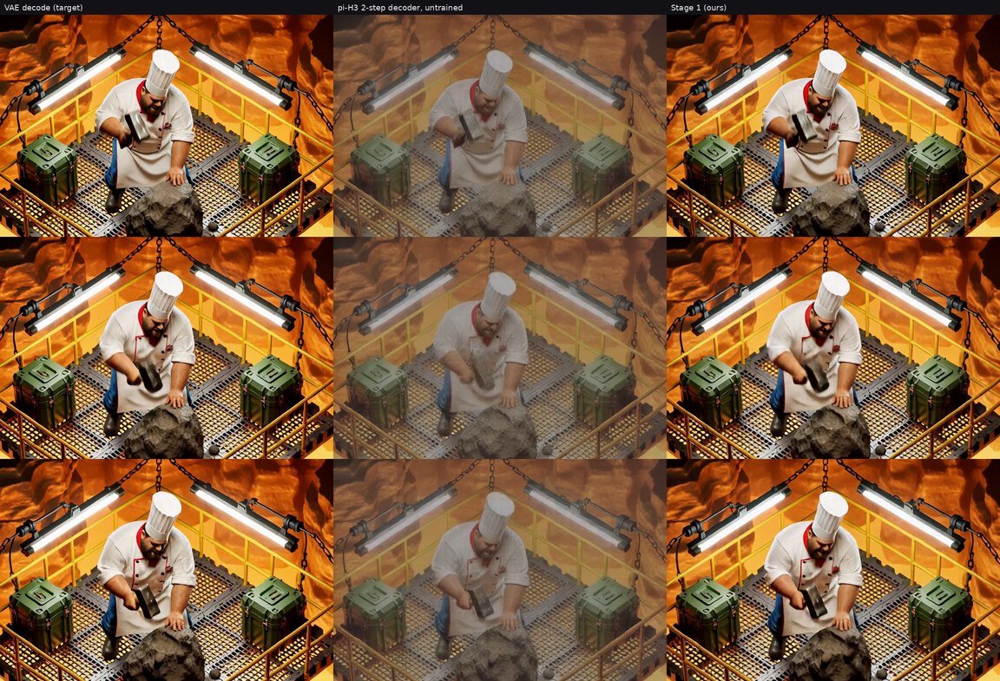
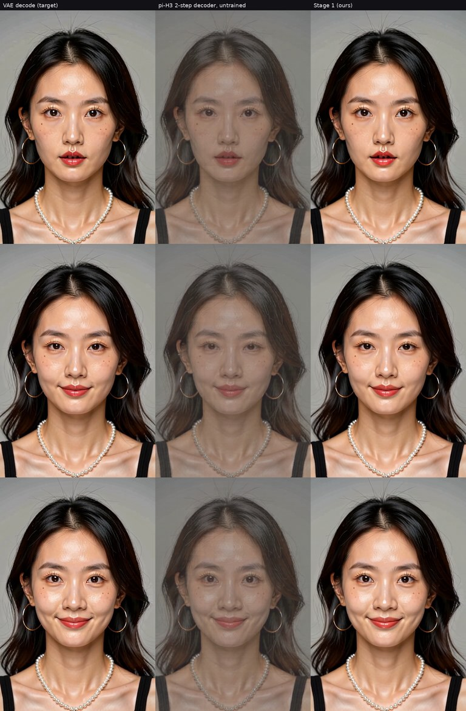

# pi-H3's DWD decoder on DiR

Our DWD v0.2 for DiR is a linear head plus an 8M-parameter refiner, read after rerunning DiR's last 8 blocks with a LoRA. pi-H3 (Hansheng Chen, Shengqu Cai, Jiaming Song, Gordon Wetzstein, Xinchen Yan and Leonidas Guibas; Apache-2.0) decodes with a modulated norm and 8 Sol-H3 ViT decoder blocks. This branch puts pi-H3 2-step's decoder on DiR. Not affiliated with the pi-H3 authors.

## Pieces

- `lot/pih3_dwd.py`: a trainable forward of ComfyUI-piFlow's `SolH3DWDHead.refine` (layer by layer, the ring slots mapped back to clip rows). `lot/test_pih3_dwd.py`: exact against `refine` under the eager path (rel 0.0), 51.6 dB against the fused int8 kernels (their own rounding), window coverage a permutation, backward through the frozen int8 blocks (SDPA in place of int8 attention, training only). Warm decode 0.07 s at 768x512x39.
- `lot/train_pih3_dwd.py`: Stage 1 freezes the 8 Sol blocks and trains `dwd_norm_out`, `feature_expand` and a new zero-initialised branch from DiR's final-iteration input state into the expanded tokens. `--sol-lora` (Stage 2) adds a LoRA to every Sol linear; shelved, so the frozen blocks stay shared with pi-H3 2-step and its alpha head.
- `lot/compare_dwd_s1.py`: the head-to-head below. Needs a 32 GB card (v0.2's two-pass tail needs every block resident).

## Results

12 held-out DiR clips (4 each from `collect_w1_{iso,atlas,kc}`), scored against the VAE decode of the same latent; LPIPS (vgg) over every frame. Stage 1: 2000 steps, 1.4 s/step on one RTX 5090, L1 + LPIPS on 320 px crops.

| Decoder | LPIPS | PSNR | Decode s |
|---|---|---|---|
| pi-H3 2-step decoder, untrained | 0.274 | 15.7 | |
| pi-H3 4-step decoder, untrained | 0.219 | 16.6 | |
| Our DWD v0.2 (LoRA + head + refiner) | 0.1168 | 28.33 | 0.222 |
| **Stage 1** | **0.1105** | 28.19 | **0.070** |

Stage 1 is better on 9 of 12 clips (all iso and kc), slightly worse on 3 atlas portraits. The v0.2 decode time leaves out its rerun of the last 8 DiT blocks with the LoRA, which Stage 1 does not need at all, so the real gap per clip is larger. The input-state branch is used (weight norm 0 -> 5.7), so a ComfyUI node for DiR needs it; ComfyUI-piFlow's DWD node alone does not load it.

Per clip: `docs/dwd_pih3_compare.json`.

## Pictures

Held-out clips, columns: VAE decode (the target) | pi-H3 2-step's decoder on DiR, untrained | Stage 1. Rows: first, middle and last frame. Made by `lot/media_dwd_pih3.py` (runs on a 24 GB card with block swap).




Whole clips side by side: [`iso_held_0001_0.mp4`](dwd_pih3_media/iso_held_0001_0.mp4), [`atlas_held_0001_0.mp4`](dwd_pih3_media/atlas_held_0001_0.mp4). Untrained, the pi-H3 decoder already draws DiR's scene but washed out; Stage 1 restores contrast and colour.

## Train it from a fresh setup

**Hardware.** One 32 GB GPU (RTX 5090) for collection, training (1.4 s/step, 29.5 GB) and `compare_dwd_s1.py`. `media_dwd_pih3.py` and inference fit a 24 GB card with `--swap`.

**1. Code and Python.**
```bash
git clone -b feat/dwd-pih3 https://github.com/scrya-com/dir-diffusion && cd dir-diffusion
# Python 3.12 with PyTorch (CUDA), plus:
pip install lpips setproctitle safetensors huggingface_hub
```
musubi-tuner's `src` must be importable: vendored under `third_party/`, or set `MUSUBI_SRC`.

**2. ComfyUI as a library, for pi-H3's decoder code.** A ComfyUI tree at v0.45 or newer with [ComfyUI-piFlow](https://github.com/Lakonik/ComfyUI-piFlow) in `custom_nodes/` (its `sol_h3.py` and `loader_utils.py` are imported; comfy-kitchen comes with ComfyUI). Point `LOT_PIH3_COMFY` at the tree's root.

**3. Models.**
```bash
hf download Comfy-Org/MiniMax-H3 diffusion_models/minimax_h3_fl2va_pruned_int8_convrot.safetensors --local-dir models
hf download Comfy-Org/MiniMax-H3 vae/minimax_h3_video_vae_fp16.safetensors --local-dir models          # name as in your ComfyUI
hf download Lakonik/pi-H3 pi_h3_2step_dwd_adapter_int8_convrot.safetensors --local-dir models/pi_h3
hf download johndpope/dir-diffusion-h3 --local-dir lot/runs/dir_h3                                     # DiR generator
export LOT_H3_CHECKPOINT=$PWD/models/diffusion_models/minimax_h3_fl2va_pruned_int8_convrot.safetensors
export LOT_H3_VAE=$PWD/models/vae/minimax_h3_video_vae_fp16.safetensors
export LOT_PIH3_ADAPTERS=$PWD/models/pi_h3
```
`lot/lot_paths.py` lists every path setting. The text encoder (`LOT_H3_TEXT_ENCODER`, Qwen3-VL-32B) is needed only to cache prompts.

**4. Prompts.** A cache of H3 text embeddings (`*_minimaxh3_te.safetensors`): `lot/build_cache_h3.py media --src DIR --out CACHE` (images with same-stem `.txt` captions), then `lot/build_cache_h3.py text --out CACHE`. Our three sets were isometric scenes, portraits and known-character prompts.

**5. Training data: DiR's final iteration, and its VAE decode** (about 10 s per sample; we used about 3,900):
```bash
cd lot
python3 train_dwd_h3.py collect --light --run runs/dir_h3 --cache CACHE --max-latent-hw 32 48 \
    --out DATA/set1 --items 750 --seeds 2 --held-items 8 --held-seeds 1 --swap 0
python3 train_dwd_h3.py targets --data DATA/set1          # the VAE decode of each sample, as mp4
```

**6. Check the decoder forward, then train Stage 1.**
```bash
python3 test_pih3_dwd.py --steps 2                        # exact vs eager refine, coverage, backward, timing
python3 train_pih3_dwd.py --data DATA/set1 [DATA/set2 ...] --out RUN --steps 2000 --eval-every 500
python3 compare_dwd_s1.py --stage1 RUN/best.pt            # needs v0.2's weights (johndpope/dir-diffusion-h3-dwd); edit V02 paths
python3 media_dwd_pih3.py --stage1 RUN/best.pt --out ../docs/dwd_pih3_media --data DATA/set1
```
`train_pih3_dwd.py` evaluates on the first 4 held-out samples of each `--data` folder and keeps `best.pt`. Stage 2 (`--init RUN/best.pt --sol-lora 32`) is optional and changes the shared decoder blocks.
