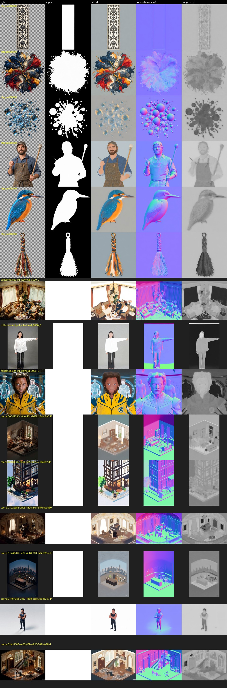

# G-buffer channels for the training sources: albedo, normals, roughness, alpha

**Status: prototype on `exp/h3tiny-gbuffer`.** `lot/gbuffer.py` writes the channels next to a manifest and loads them back aligned with the source frames. A small subset is written (20 RGBA stills, 3 clips, 8 cached stills). No trainer is changed.

**The channels are estimates, not ground truth**, except alpha, which is copied from the RGBA source.



## Estimators and licences

**Marigold** is by **Bingxin Ke, Kevin Qu, Tianfu Wang, Nando Metzger, Shengyu Huang, Bo Li, Anton Obukhov and Konrad Schindler** (ETH Zurich; [project](https://marigoldcomputervision.github.io/)). The pipelines used are the ones in `diffusers`.

| Channel | Model | Weights licence | Code licence | Picked |
|---|---|---|---|---|
| Albedo, roughness (and metallicity, not stored) | [`prs-eth/marigold-iid-appearance-v1-1`](https://huggingface.co/prs-eth/marigold-iid-appearance-v1-1), commit `e7280a0` | CreativeML Open RAIL++-M | Apache-2.0 (`diffusers` `MarigoldIntrinsicsPipeline`) | ✅ |
| Normals | [`prs-eth/marigold-normals-v1-1`](https://huggingface.co/prs-eth/marigold-normals-v1-1), commit `09cfdd2` | CreativeML Open RAIL++-M | Apache-2.0 (`MarigoldNormalsPipeline`) | ✅ |
| Alpha | none | | | Copied from the source; 1 where the source has none |

Considered and not picked:

| Model | Licence | Why not |
|---|---|---|
| RGB↔X (Adobe) | **Adobe Research License: non-commercial research only** | Non-commercial |
| NormalCrafter (video normals, temporally consistent) | Weights tagged Apache-2.0 on Hugging Face; the README points to the authors for business licensing; the pipeline is a Stable Video Diffusion one, whose base has its own community licence | **Commercial terms unclear: flagged.** It is the one to evaluate if flicker turns out to matter |
| Lotus (normals, depth) | Code and `lotus-normal-g-v1-1` weights tagged Apache-2.0 | Normals only, no albedo or roughness; per frame like Marigold. A fallback for normals |

**Licence notes, flagged:**
- Open RAIL++-M allows commercial use, with use restrictions that pass on to users. It is the Stable Diffusion 2 licence; both models are fine-tuned from Stable Diffusion 2.
- The appearance model is trained on InteriorVerse (synthetic interiors). The dataset's own terms were not checked.
- Licences were read from the Hugging Face model cards and the RGB↔X repository's LICENSE file on 2026-11-24. The Marigold GitHub repository's licence file was not opened; the code used here is `diffusers`.

## What is written

| Channel | Encoding | Range |
|---|---|---|
| `albedo` | RGB, sRGB | [0, 1] |
| `normals` | Camera space, unit length: **X right, Y up, Z toward the viewer**; stored as `(n + 1) / 2` | [−1, 1] after decoding, re-normalised |
| `roughness` | 1 channel, linear | [0, 1] |
| `alpha` | 1 channel, the source's own, 8 bits, exact | [0, 1] |

```
/media/2TB/gbuffer/                     LOT_GBUFFER_ROOT, not in git
  t2rgba/manifest.json
  t2rgba/000000/{albedo,normals,roughness,alpha}.png        stills: PNG, lossless
  collect/collect_w1_iso/held_0000_0/{albedo,normals,roughness}.mp4     clips: x264 crf 8, 4:4:4
  cache/<uuid>/{albedo,normals,roughness}.png
```

`manifest.json` holds the source name, per channel the model, its commit, licence, `diffusers` version, steps, working resolution and seed, the normals' frame, the matte grey, and per item: id, source path, still or clip, width, height, frame count, whether it has alpha, the files, seconds per frame and bytes.

**Sources:**

| `--source` | Items | Frames come from |
|---|---|---|
| `t2rgba` | 8,963 RGBA stills (`/media/2TB/alpha/data/t2rgba_train.jsonl`) | The PNG. The estimators see it over mid-grey (0.5); alpha is copied |
| `collect` | 3,960 target clips, 39 frames (`dwd/collect_w1_{iso,atlas,kc}/*.mp4`) | The mp4, every frame |
| `cache` | 801 cached stills (`cache_iso3d`) | **The source image** (`isometric_3d_stills/<uuid>.jpg`), cover-resized and centre-cropped to the cache's size. All 801 have one. `--decode-missing` VAE-decodes a latent that has none (written, not exercised) |

## Commands

```bash
pip install --no-deps --target /media/2TB/gbuffer/.pyoverlay diffusers==0.40.0   # once; the env is not changed
CUDA_VISIBLE_DEVICES="" python3 lot/test_gbuffer.py                               # last line "ok 5"
cd lot && export CUDA_DEVICE_ORDER=PCI_BUS_ID CUDA_VISIBLE_DEVICES=0              # the RTX PRO 4000
python3 -u gbuffer.py size                                  # item counts; full-set size and hours from what is written
python3 -u gbuffer.py build --source t2rgba --limit 200     # default 200 items; --limit 0 is everything
python3 -u gbuffer.py build --source collect --limit 200
python3 -u gbuffer.py build --source cache --limit 200
python3 -u gbuffer.py sheet --count 6 --out sheet.jpg
```

The env's `diffusers` 0.32 does not import with its `transformers` 5.14, and 0.43 needs a newer `huggingface_hub`. 0.40.0 in an overlay folder works and leaves the env (which a training job is using) alone. The two models take 9.8 GB in the Hugging Face cache on `/`, of which half is duplicate `.bin` files a first download pulled in.

**Loader:**

```python
from gbuffer import GBufferSet
gset = GBufferSet("collect")                          # or "t2rgba", "cache"
rgb, alpha, albedo, normals, roughness = gset.load(gset.ids()[0])
# float32 (F, C, H, W): rgb, albedo 3 channels in [0, 1]; alpha, roughness 1 channel; normals unit vectors
```

A still has `F = 1`. `rgb` is the source's own colour, straight (not matted). A channel whose frame count or size differs from the manifest raises instead of loading misaligned. `alpha/data_pih3.py` and `train_pih3_dwd.py` are not changed; both can call `load` by item id (the RGBA stem; `<set>/<clip stem>`).

## CPU tests (fake estimator, synthetic sources)

| Test | Result |
|---|---|
| Normal encoding | Decoded normals are unit length (error < 1e-5), within 0.5° of the input; mid-grey decodes to +Z ✅ |
| Manifest round trip | Written = reloaded; versions, channels, per-item fields; resume estimates nothing twice and redoes an item with a missing file ✅ |
| Alignment | All five tensors share `(F, H, W)` for stills and a 7-frame clip; frame `t` of a channel belongs to frame `t` of the source (off by one frame is over 5× worse); a 5-frame channel for a 7-frame clip raises ✅ |
| Alpha passthrough | Bit-exact for an RGBA still; ones for RGB sources; `rgb` stays straight; the estimator sees the still over grey ✅ |
| Sources | jsonl stills, round-robin clips over the sets, cache items fitted to the cache's size, `decode_missing` ✅ |

## GPU run (RTX PRO 4000 Blackwell)

4 steps, working resolution 768 on the longer side, fp16, batch 4, one seed for every frame. Time is per frame for all three channels, file reading included.

| Source | Items | Frames | Size | s per frame | Written | Peak GPU |
|---|---|---|---|---|---|---|
| `t2rgba` | 20 | 20 | 1024×1024 | 1.12 | 29 MB | 6.2 GB |
| `collect` | 3 (one per set) | 117 | 608×512, 512×768, 512×512 | 0.97 | 11 MB | 9.4 GB |
| `cache` | 8 | 8 | 784×1168 and others | 0.78 | 13 MB | 5.8 GB |

On real outputs the loader returns aligned tensors, normals of unit length (error 2e-7) and a mean Z of 0.68–0.88 (they face the viewer, as the stated frame says).

**Full sets, scaled from the run** (`gbuffer.py size`):

| Source | Items | Disk | PRO 4000 time |
|---|---|---|---|
| `t2rgba` | 8,963 | 13.1 GB | 2.8 h |
| `collect` | 3,960 clips = 154,440 frames | 14.8 GB | 41.7 h |
| `cache` | 801 | 1.3 GB | 0.2 h |
| All | | **29 GB of the 61 GB free on /media/2TB** | 45 h |

The default of 200 items per source is 0.3 GB + 0.7 GB + 0.3 GB and about 2.4 hours, almost all of it the clips. Do not run `--limit 0` on `collect` without freeing disk first.

## Known limits

- **Estimated, not ground truth.** No renderer produced these. Albedo still carries some shading; roughness is the weakest channel.
- **Out of domain.** The appearance model is trained on synthetic interiors. People, stylised characters and isometric dioramas are outside it. On the sheet the kc clip's albedo flattens the face well, while its roughness is mostly a silhouette.
- **Flicker on video.** Each frame is estimated alone. All frames of a clip share one noise seed, which removes the sampling noise's share only. Measured on the 3 clips: normals turn 1.8–2.0° per frame on average, and albedo changes 0.008–0.011 per frame where the source changes 0.007–0.014. That includes real motion; it is not separated from flicker. Not viewed as video.
- **RGBA stills are estimated over mid-grey.** Outside the matte the channels describe the grey, so mask them with alpha. Semi-transparent edges mix in grey.
- **The matte and the frame are choices.** Normals follow Marigold's documented frame (X right, Y up, Z toward the viewer); the sign check above is the only verification.
- **Clips are stored lossy** (x264 crf 8, 4:4:4). Normals are re-normalised on load.
- **`roughness` drops metallicity**, which the model also predicts. Adding it is one more file per item.

## If the channels condition generation later: how they would enter H3-Tiny (sketch, not built)

The 42-block model is the same network with blocks skipped, so everything below applies to H3 at any depth. Token counts are for 768×512×39 (4,866 rows: 4,608 video, 130 audio, 128 text).

| Route | How | DiT cost | Risk |
|---|---|---|---|
| **A. Extra latent channels** (recommended first) | Encode each map with the H3 video VAE to a 24-channel latent, the same grid as the video. Widen `video_patch_proj` from 96 inputs to 96 × (1 + maps), new columns zero: the model is unchanged at step 0. Train the new columns and a LoRA | **None in the blocks**: the row count is unchanged. The projection is one fp32 Linear | The VAE was never trained on normals or roughness maps; its reconstruction of them is untested. 3 extra VAE encodes per clip at preparation |
| B. Condition rows | Pack the map latents as extra rows, as H3 packs first/last frames and references | Rows grow from 4,866 to 9,474 for one map and 18,690 for three. Per-block time grew ×3.46 for ×2.45 rows here (exponent 1.39), so about **×2.5 for one map and ×6.5 for three** (extrapolated) | No new weights and native to H3, but it gives back the whole drop many times over. Pooling the maps 2× in each direction cuts the added rows to a quarter (about ×1.3 for one map) |
| C. Control branch | A trainable copy of the first K blocks reads the maps and adds residuals into the main stack | + K / 42 of DiT time and 0.42 GB per block: **+19% and 3.4 GB for K = 8**, which cancels H3-Tiny's 16% | Most weights to train (K × 0.4 B) |

For **predicting** the channels instead (a G-buffer out of the generator), the cheap route is the one the alpha head already uses: a small head on the DWD decoder's taps, trained against these files, at the cost of a decode pass and no DiT time.

Guesses in this sketch: the exponent carries to 18,690 rows; the VAE can represent the maps; the 0.42 GB per block of the int8 weights.
