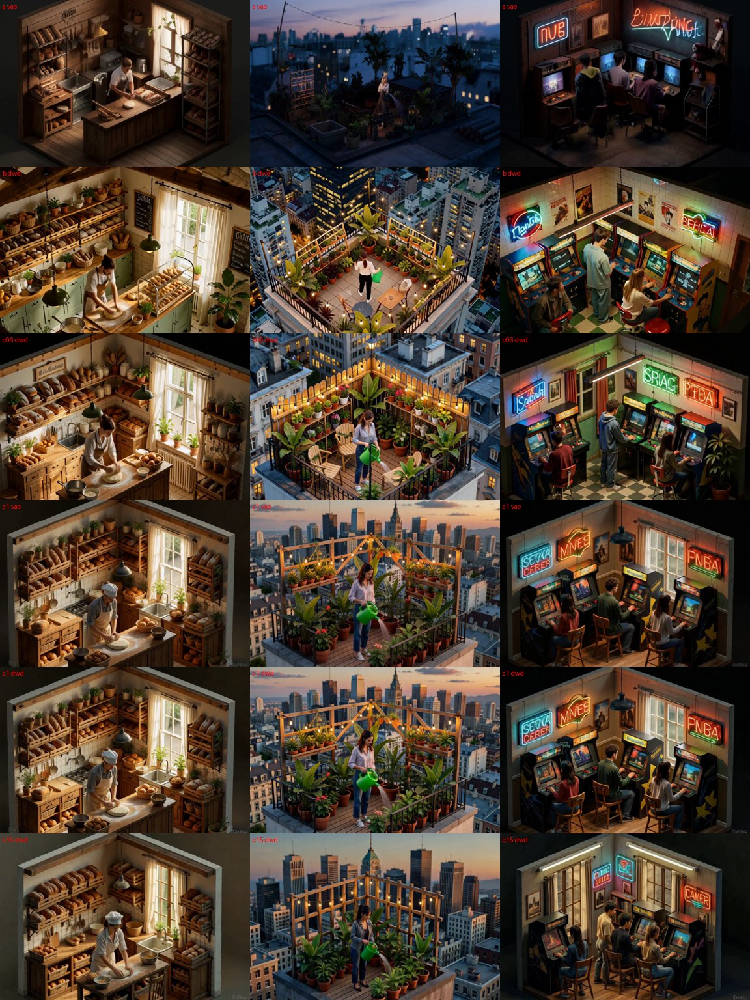

# Isometric style on DiR + DWD

DiR's 4-iteration generator and DWD's pixel decode run with an isometric style adapter: fizgig's `scrya_iso_scene` LoKr (factor 8, all 258 block layers including adaLN, 15 epochs on `minimax_h3_fl2va_pruned_int8_convrot`, the same base as DiR and DWD). Nothing was retrained.

## How

The ComfyUI **DiR H3 Loader** takes the adapter on its `style_lora` / `style_strength` inputs. The loader runs it in bypass next to the DiR generator LoRA, summing the two per layer in one injection, so the int8 weights are never touched. The DWD re-run of blocks 42–49 uses the same injected layers, so it sees the style too.

Workflow: `comfyui/dir_dwd_h3_iso.json` (API: `dir_dwd_h3_iso_api.json`). Start the prompt with the trigger `scrya_iso_scene,`.

**Do not put a stock Load LoRA (Bypass) node in front of the DiR loader.** ComfyUI keeps one bypass injection per model, under the key `bypass_lora`. A second `load_bypass_lora_for_models`, here the DiR generator LoRA, replaces the first, so the style silently disappears. The first test run hit exactly this: the style made no visible difference. The loader now refuses a model that already has a bypass LoRA.

## Results

RTX 5090, 768×512, 39 frames, seed 7, three prompts:

| arm | look | DWD vs VAE PSNR (dB, 3 prompts) | motion (VAE) |
|---|---|---|---|
| base fl2va + iso LoKr, 20-step res_multistep | isometric cutaway diorama, dark backdrop (the style reference) | — | — |
| DiR + DWD, no style | busy top-down, Turbo-like | 27.2 / 24.5 / 27.2 | 2.85 / 3.30 / 2.18 |
| DiR + DWD, iso 0.6 | partly isometric | 28.6 / 26.7 / 28.7 | 2.59 / 2.45 / 1.60 |
| DiR + DWD, iso 1.0 | isometric diorama, close to the 20-step reference | 28.9 / 27.0 / 28.4 | 2.09 / 2.16 / 1.50 |
| DiR + DWD, iso 1.5 | stronger diorama, darker | 29.0 / 28.3 / 28.7 | 1.77 / 1.58 / 1.63 |

Motion is the mean absolute difference between consecutive frames (0–255 scale).

- **The style carries through DiR at strength 1.0.** No distillation was needed.
- **DWD holds up with the style on.** It stays as close to the VAE as without the style (closer, in fact), so the DWD head and refiner needed no refit.
- **Motion drops with the style,** in line with the training clips' locked-off camera.
- **Known artifact:** a small "scrya" watermark sometimes appears bottom-right. It comes from the training data.

## Ref2VA + isometric

A reference character in isometric scenes. Use the fl2va DiT, MiniMax H3 Reference to Video (the reference image as `<Picture 1>`), and the DiR loader's `style_lora`. The workflow is `comfyui/dir_dwd_h3_ref2va_iso.json`.

RTX 5090, `hub.png`, 768×512, 39 frames, seed 7. Rows: no style (DWD), iso 1.0 (VAE), iso 1.0 (DWD), iso 1.5 (DWD).

- **Identity:** her hair, face and black zip suit carry into every scene, at both strengths.
- **Style:** 1.0 gives the cutaway-diorama rooms; 1.5 gives a darker, more model-like look.
- **DWD:** matches the VAE decode.
- **Checkpoint:** the ref2va checkpoint is not usable with DWD yet, because the head is being refit on its features.

## If the style ever needs to be distilled in

`LOT_H3_BASE_LOKR=PATH[:STRENGTH]` (`lot/base_lokr.py`, read by `h3_musubi.load_dit`) makes the LoKr part of the frozen base in every `lot/` script. In `train_dir_h3.py`, the teacher, generator and fake then all see base + adapter: DMD with an isometric teacher. In `train_dwd_h3.py`, collect, refit and ft see it too. ComfyUI's styled path matches `dir_sample` + `base_lokr` on the tiny CPU H3 (`tests/test_cpu.py`).
