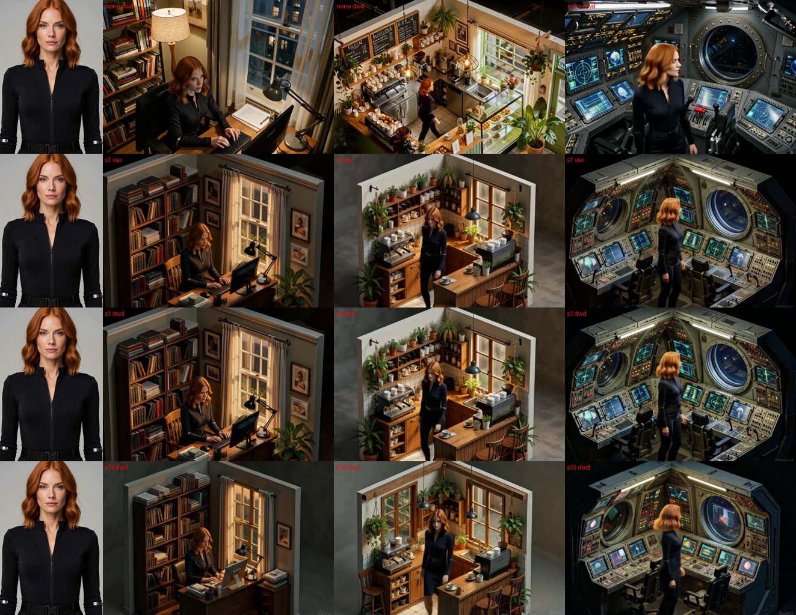
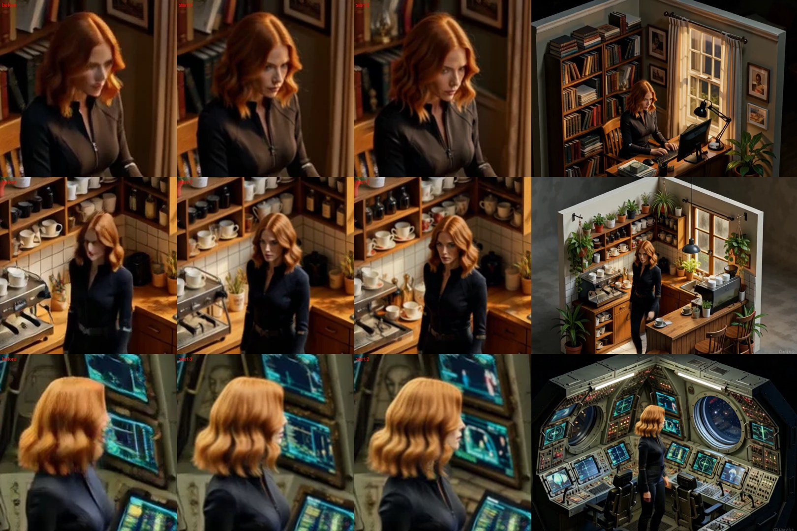
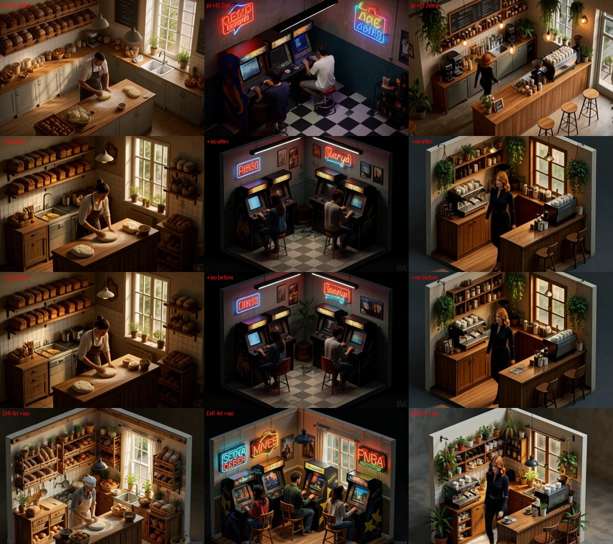
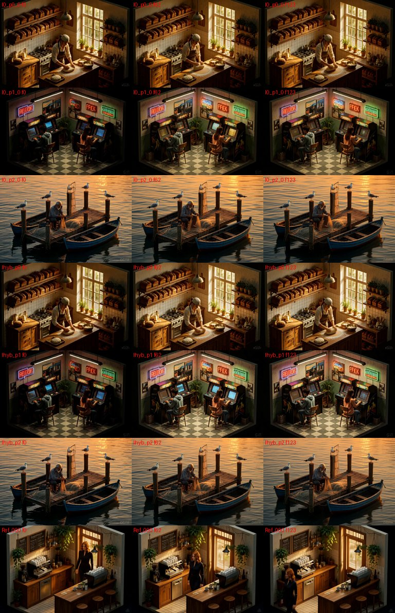
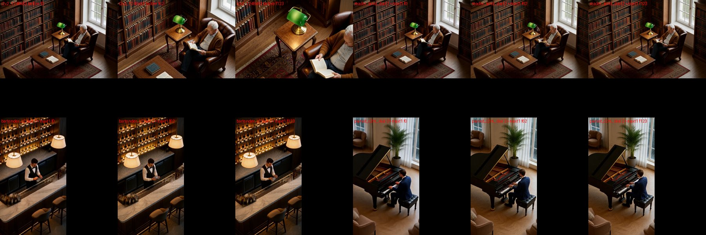

# Isometric style on DiR + DWD

DiR's 4-iteration generator and DWD's pixel decode run with an isometric style adapter: fizgig's `scrya_iso_scene` LoKr (factor 8, all 258 block layers including adaLN, 15 epochs on `minimax_h3_fl2va_pruned_int8_convrot`, the same base as DiR and DWD). Nothing was retrained.

## How

The ComfyUI **DiR H3 Loader** takes the adapter on its `style_lora` / `style_strength` inputs. The loader runs it in bypass next to the DiR generator LoRA, summing the two per layer in one injection, so the int8 weights are never touched. The DWD re-run of blocks 42–49 uses the same injected layers, so it sees the style too.

Workflow: `comfyui/dir_dwd_h3_iso.json` (API: `dir_dwd_h3_iso_api.json`). Start the prompt with the trigger `scrya_iso_scene,`.

**Do not put a stock Load LoRA (Bypass) node in front of the DiR loader.** ComfyUI keeps one bypass injection per model, under the key `bypass_lora`. A second `load_bypass_lora_for_models`, here the DiR generator LoRA, replaces the first, so the style silently disappears. The first test run hit exactly this: the style made no visible difference. The loader now refuses a model that already has a bypass LoRA.

## Results

RTX 5090, 768×512, 39 frames, seed 7, three prompts:

| arm | look | DWD vs VAE PSNR (dB, 3 prompts) | motion (VAE) |
|---|---|---|---|
| base fl2va + iso LoKr, 20-step res_multistep | isometric cutaway diorama, dark backdrop (the style reference) | — | — |
| DiR + DWD, no style | busy top-down, Turbo-like | 27.2 / 24.5 / 27.2 | 2.85 / 3.30 / 2.18 |
| DiR + DWD, iso 0.6 | partly isometric | 28.6 / 26.7 / 28.7 | 2.59 / 2.45 / 1.60 |
| DiR + DWD, iso 1.0 | isometric diorama, close to the 20-step reference | 28.9 / 27.0 / 28.4 | 2.09 / 2.16 / 1.50 |
| DiR + DWD, iso 1.5 | stronger diorama, darker | 29.0 / 28.3 / 28.7 | 1.77 / 1.58 / 1.63 |

Motion is the mean absolute difference between consecutive frames (0–255 scale).

- **The style carries through DiR at strength 1.0.** No distillation was needed.
- **DWD holds up with the style on.** It stays as close to the VAE as without the style (closer, in fact), so the DWD head and refiner needed no refit.
- **Motion drops with the style,** in line with the training clips' locked-off camera.
- **Known artifact:** a small "scrya" watermark sometimes appears bottom-right. It comes from the training data.

## Ref2VA + isometric

A reference character in isometric scenes. Use the fl2va DiT, MiniMax H3 Reference to Video (the reference image as `<Picture 1>`), and the DiR loader's `style_lora`. The workflow is `comfyui/dir_dwd_h3_ref2va_iso.json`.

RTX 5090, `hub.png`, 768×512, 39 frames, seed 7. Rows: no style (DWD), iso 1.0 (VAE), iso 1.0 (DWD), iso 1.5 (DWD).

- **Identity:** her hair, face and black zip suit carry into every scene, at both strengths.
- **Style:** 1.0 gives the cutaway-diorama rooms; 1.5 gives a darker, more model-like look.
- **DWD:** matches the VAE decode.
- **Checkpoint:** the ref2va checkpoint is not usable with DWD yet, because the head is being refit on its features.

## Face detailer

In these wide isometric shots a face is about 2×2 DiT tokens, too few for eyes or a mouth. The VAE and DWD decodes are equally smeared, so the decode is not the cause. Two-track cannot fix it either: its full-resolution steps come too late to redraw features (`docs/TWO_TRACK.md`).

**DiR H3 Face Detailer** fixes this in a second pass:
1. Finds one face box for the clip.
2. Upscales the crop to 512 px, so the face gets roughly 16×16 tokens.
3. Re-noises the crop and finishes it with DiR's last iterations, using a close-up Ref2VA prompt with the same reference.
4. Blends it back.

The workflow is `comfyui/dir_dwd_h3_ref2va_iso_face.json`.

RTX 5090, same three scenes and seed. Columns: before (DWD), detailer from iteration 3 (σ 0.667, 1 forward), from iteration 2 (σ 0.857, 2 forwards), and the full frame with iteration 2.

| Scene | Box (px) | Upscale | Motion in box: before / start 3 / start 2 |
|---|---|---|---|
| office | 179 | 2.9× | 1.87 / 1.52 / 1.80 |
| coffee shop | 233 | 2.2× | 6.77 / 6.00 / 6.26 |
| spaceship (she faces away) | 163 | 3.1× | 6.43 / 6.02 / 6.40 |

- **Faces:** the coffee-shop face goes from a smear to eyes, nose and mouth that match the reference. The office face gets sharper eyes and brows. The back view barely changes.
- **Flicker and seams:** no added flicker, and no visible seam.
- **Which start to use:** start 3 keeps closer to the original; start 2 redraws a little more.
- **Limit:** the redrawn face is pasted back at its original size (about 30 px of face). Detail finer than the output resolution is lost, so for close-ups render larger.

## Two steps: pi-H3 + isometric (the fast path)

Speed comes first, so the isometric style and Ref2VA were tried on pi-H3's 2-step adapter (LakonLab, by Hansheng Chen, Shengqu Cai, Jiaming Song, Gordon Wetzstein, Xinchen Yan and Leonidas Guibas) with its own DWD decode. Nothing was trained.

Workflows (API format, ComfyUI-piFlow nodes): `comfyui/pih3_2step_iso_api.json` (text) and `comfyui/pih3_2step_iso_ref2va_api.json` (Ref2VA).

RTX 5090, 768×512, 39 frames, seed 7. Rows: pi-H3 2-step; + iso LoKr in bypass after the adapter; + iso LoKr in bypass before it; DiR 4 iterations + iso, for comparison.

- **Style:** the iso LoKr carries through pi-H3's two steps. The arcade and the coffee shop become cutaway dioramas; the bakery less so than with DiR.
- **Ref2VA:** the reference identity holds, and the person is drawn larger than with DiR.
- **Placing the LoKr:** after the adapter and before it look almost the same.
  - The adapter replaces adaLN in every block and all of blocks 46–49 as weight patches, so a LoRA placed before it loses those parts.
  - Put the LoKr after the adapter, in bypass. Never merge it into the int8 weights.
- **Speed:** about 4 s per clip warm, including the text encode. DiR + DWD took 21–37 s per run here, model loading included; earlier benchmarks put its warm time at about 4.5 s.
- **Not yet ported:**
  - The face detailer runs on DiR's sampler.
  - Our DiR loader takes exactly 4 sigmas, so a 2-iteration DiR would need retraining.

## pi-H3 camera zoom, and why the isometric path is immune

pi-H3 clips conditioned on an image push in steadily, whatever the prompt says.
- **How it was measured:** ORB features + a similarity fit from the first frame to later frames. The fit recovers synthetic 1.05/1.15/1.3 zooms exactly.
- **The clip:** a 1248×832, 158-frame image-to-video run (4-step adapter, Spark attention).
- **Every variant used the same image and seed:**

| Variant | Zoom at 25 / 50 / 75 / 100% |
|---|---|
| as recorded | 1.29 / 1.77 / 2.25 / 2.46 |
| no Spark attention | 1.28 / 1.72 / 2.20 / 2.47 |
| 2-step adapter | 1.26 / 1.64 / 2.15 / 2.68 |
| adapter strength 0.8 / 0.6 | 2.47 / 2.44 at the end |
| max_raw_t 1.0 (start from pure noise) | 1.08 / 1.28 / 1.53 / 1.67 |
| first frame = last frame | 1.50 / 2.64 / 1.63 / 1.00 (in, then back out) |
| image as a Ref2VA reference instead | 1.11 / 1.29 / 1.53 / 1.73 |
| no image | 1.00 throughout |
| **base H3, 20 steps, same first frame** | **1.00 throughout** (488 s) |

**Cause: pi-H3's distillation under image conditioning.** It is not Spark, the step count, LoRAs or the prompt, and base H3 does not do it.

**With the isometric LoKr on pi-H3 (bypass, after the adapter): locked only on LoKr-native stills.**
- On three isometric first frames that the same pipeline generated (768×512 landscape), and on a Ref2VA clip, zoom measured 1.000 over 121 frames, and people still moved.
- **This does not generalise.** The Spicy session ran an A/B on non-LoKr stills (`/media/2TB/scratch-tests/iso_bypass_ab/`, 54 renders, 124 frames, seeds 7/11/23, 576×1024 portrait and 768×512).
  - The exact graph here zoomed 2.25–2.43× on all three kimmy_at_bar seeds, and up to 1.9× on chanelle_by_piano.
  - The LoKr also changed wardrobe and replaced or removed people.
  - Their `iso_vs_persp` dial at −1.5 on 4-step pi-H3, with no LoKr, held about 1.0 on 6 of 6 with no wardrobe change.
  - **What a dial is:** a prompt-embedding offset, the mean of (perspective − isometric) over 28 matched prompt pairs, taken after H3's text refiner. It is added at a strength to every prompt token. Negative strength means more isometric; −2 or below overshoots into a white void.
  - **Files:** `/media/2TB/lora-data/dials/iso_vs_persp.safetensors` (with `iso_nocut.safetensors`), applied with the ComfyUI-Dials pack (`DialsLoadDial` + `DialsApplyDial`, after the attention node, feeding both the guider and the scheduler).
  - **Write-up:** `/media/2TB/scratch-tests/iso_dial/findings.md`.
- **Use the LoKr only on stills it generated itself, or on text-to-video.** For image-to-video from other stills, use the dial guard.

Rows: pi-H3 + iso image-to-video (3 scenes), the same with one base-H3 first step (not needed), and Ref2VA + iso; frames 0, 62 and 123.

- **Workflow:** `comfyui/pih3_2step_iso_i2v_api.json`, isometric image-to-video at 768×512, 121 frames. Only for LoKr-native first frames; see above.
- **Time:** 22–39 s per 5 s clip on the RTX 5090, including image encode and text encode.

## Fixing pi-H3's image-conditioned camera drift

**Cause:** the drift is pi-H3's own. With a first frame, pi-H3 pushes in (or sometimes pulls out), and base H3 at 20 steps does not. The SFW reproduction is public at https://huggingface.co/datasets/johndpope/pi-H3-zoom-repro and reported on `Lakonik/pi-H3`.

**Fix, no training: a camera dial at −2 plus `max_raw_t` 1.0.**
- The dial is `cam_static`: 6 prompt pairs × 4 subjects, "camera on a tripod" vs "camera pushes in", built with ComfyUI-Dials `DialsMakeDial` (post-refiner hook).
  - File: `/media/2TB/lora-data/dials/cam_static.safetensors`, also in ComfyUI `models/loras/dials/`.
  - Pairs: `comfyui/dials/cam_static_pairs.txt`.
- `max_raw_t` 1.0 makes the pi-Flow scheduler start from pure noise instead of 0.93.
- Workflow: `comfyui/pih3_2step_i2v_camlock_api.json`.

Zoom from frame 0 to the end of 121 frames, pi-H3 2-step, seed 7:

| First frame | No fix | dial −2 | `max_raw_t` 1.0 | **both** |
|---|---|---|---|---|
| bartender, 576×1024 | 1.89 | 1.00 | 1.02 | **1.00** |
| pianist, 576×1024 | 1.38 | 1.00 | 1.00 | **1.00** |
| reader, 1248×832 | 2.15 | 1.96 | 1.26 | **1.00** |

Other things tried:

| Tried | Result |
|---|---|
| dial at −1 | 1.62 on the bartender |
| the `iso_vs_persp` dial at −1.5 | 1.62 on the bartender |
| base H3 for the first 4 steps, then pi-H3 | camera locked, but dark blotch artifacts and 74 s per clip |

**Is the motion preserved?** The people keep moving: the reader turns his page, the bartender polishes, the pianist plays. Cost: nothing extra, 21–46 s a clip on the RTX 5090, the same as without the fix.

Rows: the reader before the fix and with it; then the bartender and pianist with the fix. Frames 0 / 62 / 123.

**Not yet tested:** the 4-step adapter, Spark attention, LoRAs, and the Spicy session's stills.

## If the style ever needs to be distilled in

`LOT_H3_BASE_LOKR=PATH[:STRENGTH]` (`lot/base_lokr.py`, read by `h3_musubi.load_dit`) makes the LoKr part of the frozen base in every `lot/` script. In `train_dir_h3.py`, the teacher, generator and fake then all see base + adapter: DMD with an isometric teacher. In `train_dwd_h3.py`, collect, refit and ft see it too. ComfyUI's styled path matches `dir_sample` + `base_lokr` on the tiny CPU H3 (`tests/test_cpu.py`).
