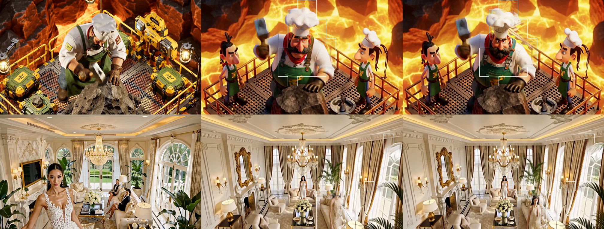

# DiR + MPEG two-track on H3

Running the [DiR generator](../README.md) inside [mpeg-diffusion](https://github.com/scrya-com/mpeg-diffusion)'s two-track sampler. The whole frame is generated at half resolution, and full-resolution tokens are added only on a region that a small head picks: the people or subject. MPEG-Diffusion is by Dennis Menn, Tianpei Gu, Guande He, Aryan V S, Yanke Song, Nan Liu, Desai Xie, Xun Huang, Chenfeng Xu and Diana Marculescu ([arXiv 2611.12069](https://arxiv.org/abs/2611.12069)). Neither paper combines the two.

**Status: works, measured, experimental.**
- **Speed:** fast-path two-track is about 2× faster than full-resolution DiR end to end.
- **Picture:** it is a *different* video, not the same one faster. Starting from half-resolution noise changes the layout and sometimes the style.
- **Region:** it is not clearly sharper than the half-resolution track.

## Reproduce

```bash
# setup as in the README (LOT_H3_CHECKPOINT, LOT_H3_VAE, and prompts via LOT_H3_STILLS_CACHE or TE=...)
python3 lot/dir_two_track_h3.py --run johndpope/dir-diffusion-h3 --check     # GPU parity -> ok=1
bash scripts/bench_two_track.sh                                              # every row below -> runs/bench_two_track/BENCH.md
```

The defaults are the published checkpoint, 39 frames, 3 prompts, `--swap 0`, both canvases and switch 2 and 3, plus the fast path. Override them with environment variables: `RUN`, `TAG`, `FRAMES`, `PROMPTS`, `SWAP`, `CANVASES`, `SWITCHES`, `FAST`. A 24 GB card needs `SWAP=8` to `16`.

One clip with the fast settings:

```bash
python3 lot/dir_two_track_h3.py --run johndpope/dir-diffusion-h3 --out runs/tt --variants two_track \
  --switch 2 --switch-upscale latent --decode crop --size 768 512 --frames 39 --prompts 2 --outline
```

The K/V maps and the region head download from [johndpope/MiniMax-H3-MPEG-Diffusion](https://huggingface.co/johndpope/MiniMax-H3-MPEG-Diffusion).

## Results (RTX 5090, 2026-11-20)

Published DiR checkpoint, 4 iterations, 39 frames. Each figure is the median of 2 warm prompts (a third prompt warms up and is left out). The total is DiT + upscale + decode.

| Canvas | Frames | Variant | Total s | DiT s | Upscale s | Decode s | Region | GPU |
|---|---|---|---|---|---|---|---|---|
| 1344x768 | 39 | DiR, full res | 16.75 | 12.34 | 0.0 | 4.41 |  | NVIDIA GeForce RTX 5090 |
| 1344x768 | 39 | DiR, half res, upscaled | 15.4 | 2.27 | 8.74 | 4.38 |  | NVIDIA GeForce RTX 5090 |
| 1344x768 | 39 | DiR two-track, switch 2 | 15.77 | 3.5 | 6.14 | 6.13 | 15% | NVIDIA GeForce RTX 5090 |
| 1344x768 | 39 | DiR two-track, switch 2 (upscale latent, decode crop) | 8.22 | 3.46 | 0.0 | 4.76 | 15% | NVIDIA GeForce RTX 5090 |
| 1344x768 | 39 | DiR two-track, switch 3 | 15.11 | 2.91 | 6.14 | 6.06 | 14% | NVIDIA GeForce RTX 5090 |
| 768x512 | 39 | DiR, full res | 5.51 | 3.66 | 0.0 | 1.87 |  | NVIDIA GeForce RTX 5090 |
| 768x512 | 39 | DiR, half res, upscaled | 6.26 | 0.85 | 3.54 | 1.88 |  | NVIDIA GeForce RTX 5090 |
| 768x512 | 39 | DiR two-track, switch 2 | 5.35 | 1.28 | 1.73 | 2.33 | 18% | NVIDIA GeForce RTX 5090 |
| 768x512 | 39 | DiR two-track, switch 2 (upscale latent, decode crop) | 2.67 | 1.26 | 0.01 | 1.4 | 18% | NVIDIA GeForce RTX 5090 |
| 768x512 | 39 | DiR two-track, switch 3 | 5.97 | 1.06 | 2.6 | 2.3 | 18% | NVIDIA GeForce RTX 5090 |


- **Upscale:** the region's estimate passes through the VAE when the region opens (`--switch-upscale crop`, mpeg-diffusion's default).
- **Decode:** the VAE decode of both tracks and the paste.
- **Fast path:**
  - `--switch-upscale latent` upscales the region in latent space, so there is no VAE round trip.
  - `--decode crop` decodes the full-resolution latent only over the region's bounding box, plus a 64 px margin. The full-frame version decodes the whole frame for a 15% region.
  - Neither needs training.

What the numbers say:
- **Two-track as published loses its gain to the VAE.** At 1344×768 it cuts DiT time to 3.5 s from 12.3 s, but the switch upscale (6.1 s) and the double decode (6.1 s) put the total back at full resolution's level.
- **The fast path fixes that.** It takes 8.2 s against 16.8 s at 1344×768 (2.0×), and 2.7 s against 5.5 s at 768×512 (2.1×), which is 0.6× real time for 1.6 s of video at 24 fps.
- **Half resolution, upscaled, is no shortcut:** its upscale is a full VAE round trip.
- **Variance:** per-prompt totals move by up to 5 s with the region's shape (the bounding box is a union over frames). The table shows medians.



At 1344×768, from left to right: full-resolution DiR, standard two-track, fast two-track. The region is outlined; this is the middle frame of 2 held-out prompts.
- **Layout and style:** two-track's layout and style come from half-resolution noise, so they differ from full-resolution DiR. Here the chef turns into a cartoon, and the room changes.
- **Inside the region:** the fast path redraws the region (the chef gains a beard), with no visible seam. Both two-track versions are softer than full-resolution DiR.
- **Not measured:** no LPIPS or PSNR yet. The two variants don't share a reference image, so they can only be judged by eye.

## Checks

`--check` runs 7 latent frames at 768×512 on the published checkpoint. It passed (`ok=1`) on 2026-11-20:
- with no region, the two-track forward equals the DiR forward with the same hooks (relative error 0);
- with zero hooks, the region changes nothing (0);
- with the region never opened, it equals `dir_sample` at half resolution (0);
- live hooks move both tracks (22% and 27%).

`--decode crop` equals the full-frame compose with a pointwise decoder (max difference 0.0). With the real VAE only the 64 px context margin at the box edge can differ.

## Next

- **DWD instead of the VAE decode.** At 1344×768 the half-resolution track is a 672×384 grid, near DWD's 768×512 training size. Decoding it with the DWD head and refiner, and only the region crop with the VAE, should take most of the 4.8 s remaining decode. This is untested, and DWD was not trained on mixed sequences.
- **Train the generator on the mixed sequence.** Neither DiR run was distilled on two-track rollouts.
